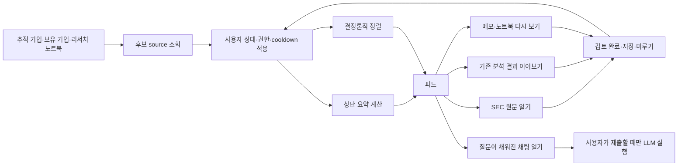
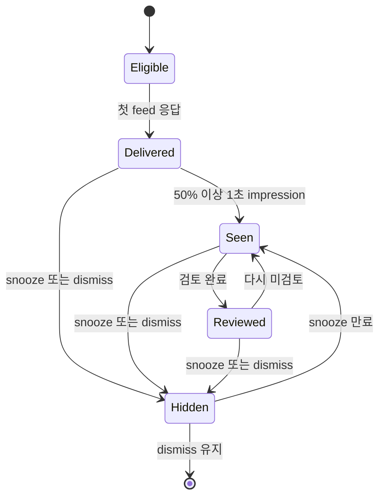

# PRD: 리서치 피드 P0 v2

## 문서 상태

- 상태: 구현·검증 완료, 프로덕션 cohort rollout 대기
- 작성일: 2026-07-15
- 대상 라우트: `/pulse`
- 사용자 노출 이름: `피드`
- 내부 기능 이름: `Research Pulse`
- 우선순위: P0
- 구현 여부: P0 v2와 한 릴리스용 legacy fallback을 구현했다. 실제 internal → 10% → 50% → 100% cohort 활성화는 운영 단계에서 `PULSE_P0_V2_ENABLED`로 진행한다.
- 이전 문서: `tasks/prd-research-pulse-feed.md`는 초기 설계 이력으로 보존한다.
- 현재 결정 우선순위: 이 문서가 이전 문서와 충돌하면 이 문서를 따른다.

## 0. 한 문장 결정

피드를 SNS형 콘텐츠 화면이 아니라 **지난 방문 이후의 공시 신호, 사용자가 시작한 분석 상태, 미완료 리서치를 중요도순으로 처리하는 유한한 리서치 인박스**로 구현한다.

## 1. 이번 명세에서 고정하는 전제

별도 사용자 질문 없이 아래 전제를 기본값으로 확정한다.

1. 피드는 필터 없는 단일 세로 목록이다.
2. 새로 발생한 미검토 공시 원문 신호가 다른 종류보다 먼저다.
3. 피드 조회와 카드 생성은 LLM을 호출하지 않는다.
4. 분석 카드는 채팅에서 사용자가 이미 시작한 작업의 저장 상태만 반영한다.
5. 무작위 AI 질문, 자동 답변, 매수·매도 추천은 만들지 않는다.
6. 체크업은 카드가 아니라 상단 요약으로 제공한다.
7. 학습·4컷은 행동 과제 수에 포함하지 않고 주 1회 이하로 제한한다.
8. 자동 무한 스크롤 대신 최근 20개와 명시적 `이전 활동 더 보기`를 제공한다.
9. 기존 `user_filing_notifications`, `agent_runs`, 질문, 노트, 노트북과 Pulse 상태 테이블을 재사용한다.
10. P0는 새 외부 SaaS, 새 상시 워커, 사용자별 생성 작업을 추가하지 않는다.

## 2. 현재 구현과 P0 v2의 차이

| 영역             | 현재 구현                | P0 v2                                         |
| ---------------- | ------------------------ | --------------------------------------------- |
| 페이지 이름      | 피드                     | 피드 유지                                     |
| 화면 필터        | 없음                     | 없음 유지                                     |
| 체크업           | 일반 카드 한 장          | 상단 요약으로 이동                            |
| 확인할 항목 수   | 모든 미읽음 카드 포함    | 행동 가능한 미검토 카드만 포함                |
| 학습 카드        | 미읽음 수에 포함         | 수에서 제외                                   |
| 새 항목 수       | 세션 polling 기준        | `새로 들어온`으로 명확히 분리                 |
| 검토 상태        | `read_at` 중심           | `reviewed_at`을 별도 의미로 추가              |
| 정렬             | 가산 점수                | 우선순위 lane + 결정론적 tuple                |
| 페이지네이션     | offset cursor            | snapshot keyset cursor                        |
| 체크업 집계 시점 | 사용자 상태 적용 전      | 숨김·snooze·cooldown 적용 후                  |
| 체크업 CTA       | 항상 공시함              | 실제 최상위 행동에 따라 동적                  |
| 분석 item key    | run 단위 하나            | run의 active/completed/failed phase 단위      |
| 다시보기 선택    | 1건 선택 후 상태 필터    | 상태 필터 후 첫 적격 후보 선택                |
| 과거 활동        | 자동 sentinel 로딩       | 사용자가 버튼을 눌러 로딩                     |
| 분석 미리보기    | 저장 답변 일부 표시 가능 | 상태와 출처 연결만 표시, 답변은 채팅에서 확인 |

## 3. 문제 정의

현재 화면은 카드 자체는 이해하기 쉽지만 세 가지 의미가 섞여 있다.

1. `확인할 항목 3개`가 질문, 체크업, 학습을 모두 과제로 계산한다.
2. 체크업이 숨김 또는 cooldown 처리되기 전 후보를 세므로 실제 목록과 숫자가 다를 수 있다.
3. 체크업에 공시가 없어도 기본 CTA가 `중요 공시 보기`다.

이 상태에서는 사용자가 피드를 할 일 목록으로 믿기 어렵다. 투자 리서치 인박스는 숫자, 정렬, 상태 의미가 항상 서로 일치해야 한다.

## 4. 목표

### 4.1 사용자 목표

- 5초 안에 지금 확인해야 할 항목 수와 가장 중요한 행동을 안다.
- 새로운 공시와 사용자가 시작한 분석 상태를 놓치지 않는다.
- 피드에서 질문·메모·노트북으로 자연스럽게 이어간다.
- 항목을 검토했는지, 저장했는지, 미뤘는지 구분할 수 있다.
- 피드가 새 분석이나 투자 판단을 몰래 만들지 않는다는 점을 이해한다.

### 4.2 제품 목표

- 공시 알림 이후 원문 확인과 리서치 시작까지 하나의 루프로 연결한다.
- 행동 가능 항목 수와 실제 화면을 항상 일치시킨다.
- 체류시간이 아니라 다음 유효 공시에서의 재방문과 근거 행동을 개선한다.
- 외부 비용과 LLM 비용을 0으로 유지한다.
- 한 source 장애가 전체 피드를 막지 않게 한다.

### 4.3 기술 목표

- `GET /api/pulse` p95 500ms 이하를 유지한다.
- 첫 응답 payload를 100KB 이하로 유지한다.
- 1,000개 후보 정렬이 로컬 단위 테스트에서 250ms 이하로 끝난다.
- mutation 후 페이지네이션에서 항목 누락이 없는 keyset cursor를 사용한다.
- 동일 입력과 snapshot 시각에 항상 동일한 순서가 나온다.

## 5. 비목표

- 실시간 주가·뉴스 종합 피드
- 시장 전체 추천 콘텐츠
- 자동 공시 요약 LLM
- 사용자별 자동 질문 생성
- 피드 진입만으로 분석 실행
- 매수·매도·보유 판단
- 밸류에이션 또는 목표주가 카드
- 사용자별 실시간 만화 생성
- 공개 댓글, 좋아요, 팔로워 수
- 광고·스폰서 카드
- P0에서 이메일·Slack·SMS 채널 추가
- P0에서 사용자 thesis 강화·약화 판정을 자동 변경
- P0에서 `next_review_at` 편집 UI 추가

## 6. 핵심 사용자 루프



## 7. P0 화면 와이어프레임

### 7.1 데스크톱 기본 상태

```text
┌──────────────────────────────────────────────────────────────┐
│ KRW.O    피드  조건 검색  관점별 분석  회사  노트북  공시 알림 │
├──────────────────────────────────────────────────────────────┤
│ RESEARCH FEED                                                │
│ 피드                                             [설정]       │
│ 7월 15일 수요일 · 미검토 2개 · 분석 진행 중 1개               │
│                                                              │
│ ┌ 오늘 요약 ───────────────────────────────────────────────┐ │
│ │ 새 공시 1 · 이어볼 리서치 1 · 진행 중 분석 1             │ │
│ │                                      [가장 중요한 항목 보기]│ │
│ └──────────────────────────────────────────────────────────┘ │
├──────────────────────────────────────────────────────────────┤
│                       [새로 들어온 1개]                       │
│                                                              │
│ ┌ 긴급 공시 · MSFT · SEC 접수 12분 전 ─────────────────────┐ │
│ │ 경영진 변경 관련 8-K가 제출되었습니다                     │ │
│ │ Item 5.02 · 정정 아님                                     │ │
│ │ [원문 보기 →]  [이 공시로 질문] [검토 완료] [내일 보기]   │ │
│ │ ▸ 왜 이 항목이 보이나요?                                 │ │
│ └──────────────────────────────────────────────────────────┘ │
│                                                              │
│ ┌ 내가 시작한 분석 · 진행 중 · AAPL ───────────────────────┐ │
│ │ 서비스 매출과 현금흐름을 연결해줘                         │ │
│ │ ● 근거 확인 중 · 새 분석을 실행한 것이 아닙니다           │ │
│ │ [채팅에서 보기 →] [숨기기]                                │ │
│ └──────────────────────────────────────────────────────────┘ │
│                                                              │
│ ┌ 이어볼 질문 · AAPL · 오늘 다시 표시 ─────────────────────┐ │
│ │ 관세·거시 외에 AAPL 개별 하락 요인이 있었는가?            │ │
│ │ 6월 16일 저장 · 같은 기업에 열린 질문 2개 더 있음         │ │
│ │ [이 질문으로 리서치 →] [질문 닫기] [내일 보기]            │ │
│ └──────────────────────────────────────────────────────────┘ │
│                                                              │
│ ───────────────── 이전에 검토한 항목 ─────────────────────── │
│ [이전 활동 더 보기]                                          │
│                                                              │
│ 확인한 활동은 여기까지입니다                                 │
└──────────────────────────────────────────────────────────────┘
```

### 7.2 모바일 기본 상태

```text
┌───────────────────────────────┐
│ ☰  KRW.O                 계정 │
├───────────────────────────────┤
│ RESEARCH FEED                 │
│ 피드                      설정│
│ 7월 15일 · 미검토 2 · 진행 1  │
│                               │
│ ┌ 오늘 요약 ────────────────┐ │
│ │ 공시 1 · 리서치 1 · 진행 1│ │
│ │ [가장 중요한 항목 보기 →] │ │
│ └───────────────────────────┘ │
│                               │
│       [새로 들어온 1개]       │
│                               │
│ ┌ 긴급 · MSFT · 12분 전 ───┐ │
│ │ 경영진 변경 관련 8-K      │ │
│ │ Item 5.02                 │ │
│ │ [원문 보기 →]        [⋯]  │ │
│ │ ▸ 왜 보이나요?            │ │
│ └───────────────────────────┘ │
│                               │
│ ┌ 분석 진행 중 · AAPL ─────┐ │
│ │ 서비스 매출과 현금흐름…   │ │
│ │ ● 근거 확인 중            │ │
│ │ [채팅에서 보기 →]    [⋯]  │ │
│ └───────────────────────────┘ │
│                               │
│ ┌ 이어볼 질문 · AAPL ──────┐ │
│ │ 관세·거시 외 개별 요인?   │ │
│ │ [이 질문으로 리서치 →] [⋯]│ │
│ └───────────────────────────┘ │
│                               │
│ [이전 활동 더 보기]           │
│ 오늘은 여기까지입니다         │
└───────────────────────────────┘
```

모바일에서 primary action은 항상 노출한다. secondary action이 세 개 이상이면 `⋯` 메뉴 또는 bottom sheet로 이동한다. `왜 보이나요?`는 카드 안에 유지한다.

### 7.3 현재 데이터에 P0를 적용한 예상 화면

현재 관찰된 화면은 `AAPL 열린 질문`, `오늘 체크업`, `주간 학습` 세 카드다. P0 알고리즘을 적용하면 다음처럼 바뀐다.

```text
피드
7월 15일 · 미검토 1개

오늘 요약
이어볼 리서치 1개
[이 질문 보기 →]

1. AAPL 다음 질문
2. 이번 주 체크리스트     ← 과제 수에는 포함하지 않음

오늘 체크업 카드          ← 제거
```

현재 체크업이 세고 있지만 실제로 보이지 않는 `다시 볼 메모 1개`는 상태 필터 이후 집계에서 제외된다.

### 7.4 새 항목 도착 상태

- 목록을 자동으로 위로 밀지 않는다.
- sticky pill에 `새로 들어온 N개`를 표시한다.
- 사용자가 누르면 snapshot을 새로 만들고 상단으로 스크롤한다.
- `prefers-reduced-motion`에서는 부드러운 스크롤과 삽입 애니메이션을 사용하지 않는다.

### 7.5 행동 가능 항목이 없는 상태

```text
피드
7월 15일 · 미검토 항목 없음

지금 확인할 신호가 없습니다
새 공시나 내가 시작한 분석 상태가 생기면 여기에 표시됩니다.

[공시 알림 기업 추가] [리서치 노트북 열기]

이번 주 학습 1건                     ← 있으면 아래에 별도 표시
```

### 7.6 일부 source 장애 상태

- 정상 카드 목록은 그대로 표시한다.
- 목록 위에 한 줄 status를 표시한다.
- 문구: `일부 리서치 항목을 불러오지 못했습니다. 공시와 나머지 항목은 정상적으로 표시됩니다.`
- source 이름과 내부 오류는 UI에 노출하지 않는다.
- filing source 장애는 일반 source 장애보다 높은 운영 경보를 발생시킨다.

## 8. 상단 요약 계약

### 8.1 요약은 카드가 아니다

`checkup` 후보를 생성해 정렬 목록에 넣지 않는다. 후보 상태를 모두 적용한 뒤 별도의 `PulseFeedSummary`를 계산한다.

### 8.2 숫자 정의

- `actionable_count`: 현재 화면에서 사용자가 처리할 수 있고 `reviewed_at`이 없는 항목 수
- `active_analysis_count`: pending, queued, running 분석 수
- `new_item_count`: 현재 브라우저 세션의 마지막 snapshot 이후 새로 available 또는 phase 전환된 행동 항목 수
- `learning_count`: 요약과 미검토 수에서 제외
- `reviewed_count`: 기본 헤더 수에서 제외하고 과거 영역에서만 사용

### 8.3 행동 가능 여부

| 종류          | 상태                                 | actionable |
| ------------- | ------------------------------------ | ---------: |
| filing        | reviewed 아님                        |       true |
| analysis      | completed 또는 failed, reviewed 아님 |       true |
| analysis      | pending, queued, running             |      false |
| question      | open이며 visible                     |       true |
| resurface     | cooldown 통과                        |       true |
| learning      | 모든 상태                            |      false |
| reviewed item | 모든 종류                            |      false |

### 8.4 요약 CTA 선택

요약의 primary action은 현재 행동 가능 후보 중 가장 높은 정렬 항목의 primary action을 그대로 재사용한다.

우선순위 예:

1. 긴급 공시가 있으면 `긴급 공시 보기`
2. 일반 공시가 있으면 `새 공시 보기`
3. 완료 또는 실패한 분석이 있으면 `분석 결과 확인`
4. 질문이 있으면 `이어볼 질문 보기`
5. 메모가 있으면 `메모 다시 보기`
6. 행동 가능 항목이 없으면 CTA 없음

요약에 공시 수가 0이면 공시 CTA를 만들지 않는다.

## 9. 카드 공통 구조

모든 카드는 다음 네 질문에 답해야 한다.

1. 무슨 일이 있었는가?
2. 어느 기업이며 언제 발생했는가?
3. 왜 내 피드에 보이는가?
4. 다음에 무엇을 할 수 있는가?

공통 렌더 순서:

1. kind/phase 라벨
2. ticker
3. 사건 시각 또는 원본 저장 시각
4. 제목
5. 사실 기반 body
6. 상태 라벨
7. primary action 한 개
8. secondary action 최대 세 개
9. `왜 이 항목이 보이나요?`

내부 정렬 lane이나 score는 사용자에게 노출하지 않는다.

## 10. 카드별 상태표

### 10.1 공통 사용자 상태

| 파생 상태 | DB 조건                                   |     화면 노출 |      요약 포함 | 정렬 영향              | 가능한 행동                |
| --------- | ----------------------------------------- | ------------: | -------------: | ---------------------- | -------------------------- |
| eligible  | state row 없음                            |            예 |    종류에 따라 | 기본 lane              | 열기, 저장, 미루기, 숨기기 |
| new       | `first_seen_at` 존재, `last_seen_at` 없음 |            예 |             예 | 같은 lane 우선         | 동일                       |
| seen      | `last_seen_at` 존재, `reviewed_at` 없음   |            예 |             예 | new 다음               | 검토 완료 포함             |
| reviewed  | `reviewed_at` 존재                        | 예, 과거 영역 |         아니오 | reviewed lane으로 이동 | 다시 미검토, 저장          |
| saved     | `saved_at` 존재                           |            예 | 원래 상태 따름 | 같은 lane에서 우선     | 저장 해제                  |
| snoozed   | `snoozed_until > now`                     |        아니오 |         아니오 | 후보 제외              | 만료 후 자동 복귀          |
| dismissed | `dismissed_at` 존재                       |        아니오 |         아니오 | 영구 제외              | 원본 화면에서만 복원 가능  |
| expired   | `expires_at <= snapshot_at`               |        아니오 |         아니오 | 후보 제외              | 없음                       |

`saved`, `snoozed`, `dismissed`는 lifecycle 상태와 독립적인 사용자 상태다. 예를 들어 `seen + saved`가 가능하다.

state row가 아직 없는 후보도 현재 응답에 포함되는 순간 API에서는 `state: "new"`로 반환한다. 응답 성공 뒤 `first_seen_at`을 idempotent upsert하므로, DB 쓰기 지연 때문에 같은 카드의 표시 문구가 바뀌지 않아야 한다.

### 10.2 공시 카드

| source 상태 | 카드 라벨           | primary action     | secondary action           | actionable | 만료/재무장                     |
| ----------- | ------------------- | ------------------ | -------------------------- | ---------: | ------------------------------- |
| urgent      | 긴급 · 먼저 확인    | SEC/공시 원문 보기 | 질문, 검토 완료, 내일 보기 |       true | 72시간 뒤 lane만 하향           |
| normal      | 새 공시             | 공시 보기          | 원문, 질문, 검토 완료      |       true | 90일 후 피드 제외               |
| digest      | 새 공시             | 공시 보기          | 질문, 검토 완료            |       true | 90일 후 제외                    |
| amendment   | `{form} 정정 공시`  | 정정 공시 보기     | 기존 공시 비교, 질문       |       true | 원본과 별도 item                |
| grouped     | `{ticker} 공시 N건` | 공시함에서 보기    | 검토 완료, 내일 보기       |       true | 그룹 notification id로 안정 key |
| reviewed    | 이전에 검토한 공시  | 다시 보기          | 다시 미검토, 저장          |      false | 과거 영역                       |

### 10.3 분석 카드

| run 상태          | phase key           | 화면 문구          | primary action     | actionable | 다음 전환             |
| ----------------- | ------------------- | ------------------ | ------------------ | ---------: | --------------------- |
| pending/queued    | `active`            | 분석 대기 중       | 채팅에서 보기      |      false | running 또는 terminal |
| running           | `active`            | 근거 확인 중       | 채팅에서 보기      |      false | completed/failed      |
| completed         | `completed`         | 분석 결과가 준비됨 | 결과 이어보기      |       true | 검토 완료             |
| failed            | `failed`            | 확인이 필요함      | 채팅에서 다시 확인 |       true | 사용자가 재실행       |
| reviewed terminal | terminal phase 유지 | 이전에 검토한 분석 | 결과 다시 보기     |      false | 과거 영역             |

item key는 `analysis:{run_id}:{phase}`를 사용한다. 사용자가 진행 중 카드를 숨기거나 검토했더라도 완료 phase는 새 항목으로 나타나야 한다.

분석 완료 카드에는 저장된 답변 전문이나 결론을 피드에서 재가공하지 않는다. `결과가 준비됨`과 원래 질문만 표시하고 답변·근거는 채팅에서 확인한다.

### 10.4 질문 카드

| 상태                |   노출 | primary action     | secondary action     | fatigue                      |
| ------------------- | -----: | ------------------ | -------------------- | ---------------------------- |
| open + visible      |     예 | 이 질문으로 리서치 | 질문 닫기, 내일 보기 | local day 최대 1 impression  |
| open + 미래 visible | 아니오 | 없음               | 없음                 | 시각 도래 후 eligible        |
| answered            | 아니오 | 없음               | 없음                 | 원본 노트북에 보존           |
| dismissed           | 아니오 | 없음               | 없음                 | 원본 상태가 바뀔 때까지 제외 |
| seen 3회 무행동     | 아니오 | 없음               | 없음                 | 7일 cooldown 후 1회 재노출   |

동일 ticker에는 첫 화면에 질문 한 개만 표시한다. 나머지는 `열린 질문 N개 더 있음`으로 알려준다.

### 10.5 다시보기 카드

| source        | 적격 기준                         | primary action | secondary action           | cooldown           |
| ------------- | --------------------------------- | -------------- | -------------------------- | ------------------ |
| research note | updated 14일 경과                 | 메모 보기      | 다시 저장, 이번에는 숨기기 | impression 후 28일 |
| notebook      | updated 30일 경과, 내용 80자 초과 | 노트북 보기    | 저장, 7일 뒤 보기          | impression 후 28일 |

source adapter는 한 건을 미리 선택하지 않고 최대 20개 raw 후보를 반환한다. 상태와 cooldown을 적용한 후 한 건을 결정론적으로 선택한다. 첫 후보가 숨김 상태여서 다시보기 전체가 사라지는 현재 문제를 방지한다.

### 10.6 학습 카드

| 상태                    |                           노출 | actionable | 제한                        |
| ----------------------- | -----------------------------: | ---------: | --------------------------- |
| 이번 주 미노출          |                             예 |      false | 첫 10개 최대 1개            |
| 이번 주 impression 완료 |                         아니오 |      false | 다음 ISO week까지 숨김      |
| saved                   | 다음 주 rotation에는 영향 없음 |      false | 노트처럼 저장 표시          |
| dismissed               |                 해당 slug 제외 |      false | 콘텐츠 revision 변경 전까지 |

학습과 4컷은 검수된 정적 manifest만 사용한다.

## 11. 클라이언트 상호작용 상태 머신



이 다이어그램은 핵심 lifecycle만 나타낸다. `saved_at`은 어느 lifecycle과도 함께 존재할 수 있는 독립 overlay다. `snoozed`와 `dismissed`도 DB에서는 별도 시각 필드이며, UI 파생 상태에서만 `Hidden`으로 묶는다. 기존 `first_seen_at` 컬럼은 호환상 유지하되 실제 의미를 `first_delivered_at`으로 문서화하고, 실제 화면 노출은 impression으로만 판정한다.

mutation UI는 optimistic update를 사용하되 실패하면 직전 목록을 복구하고 카드 근처 또는 상단 status에 재시도 가능한 오류를 표시한다. mutation 중 동일 카드 action을 비활성화한다.

## 12. 피드 알고리즘

### 12.1 알고리즘 원칙

- 머신러닝을 사용하지 않는다.
- 가산식 score가 종류 간 우선순위를 뒤집지 않게 한다.
- 먼저 lane을 고정하고 같은 lane 안에서만 보정한다.
- 같은 `snapshot_at`과 사용자 상태에서는 같은 순서가 나온다.
- source별 오류는 격리한다.
- 상태 필터 후 요약을 계산한다.
- 피드 응답을 위해 새 LLM job이나 credit reservation을 만들지 않는다.

### 12.2 전체 pipeline

```text
1. 요청 검증과 인증
2. snapshot_at 결정
   - 첫 요청: now
   - 다음 페이지: cursor.snapshot_at
3. 사용자 preference와 notebook entitlement 조회
4. source를 Promise.allSettled로 병렬 조회
   - filing
   - analysis
   - question
   - resurface raw candidates
   - learning raw candidates
5. source 후보를 공통 PulseCandidate로 변환
6. muted ticker와 entitlement 필터
7. 보유 ticker 정보 결합
8. 모든 후보 item key의 user state 일괄 조회
9. dismissed, 미래 snooze, expiry, cooldown 필터
10. resurface와 learning의 주기별 최종 후보 선택
11. actionable 및 phase 파생
12. actionable, phase, lane 및 tuple sort key 파생
13. 전체 후보를 lane + tuple로 결정론적 정렬
14. 최종 visible 후보와 정렬 결과로 상단 summary 계산
15. keyset cursor 뒤의 raw 후보 최대 20개를 page window로 고정
16. 첫 페이지라면 그 20개 안에서만 표시 다양성 순서를 조정
17. raw page window의 마지막 tuple을 next cursor 경계로 저장
18. first_seen_at을 first-delivered 의미로 idempotent 기록
19. summary, display items, source statuses, next cursor 반환
```

### 12.3 기준 pseudocode

```ts
async function composePulseFeedV2(input) {
  const snapshotAt = input.cursor?.snapshot_at ?? input.now;
  const preferences = await getPulsePreferences(input.userId);

  const settled = await Promise.allSettled([
    getFilingCandidates(snapshotAt),
    getAnalysisCandidates(snapshotAt),
    getQuestionCandidates(snapshotAt),
    getRawResurfaceCandidates(snapshotAt),
    getRawLearningCandidates(snapshotAt),
  ]);

  const sourceCandidates = collectFulfilledCandidates(settled);
  const allowed = filterPreferencesEntitlementAndMuted(sourceCandidates);
  const withHoldings = attachHoldingState(allowed);
  const states = await getPulseItemStates(
    withHoldings.map((item) => item.item_key),
  );
  const stateful = applyVisibilityState(withHoldings, states, snapshotAt);

  const resurface = selectResurfaceAfterState(
    stateful,
    input.userId,
    snapshotAt,
  );
  const learning = selectLearningAfterState(stateful, snapshotAt);
  const items = keepNonRotatingCandidates(stateful).concat(resurface, learning);

  const ranked = rankByLaneAndTuple(items, snapshotAt);
  const summary = buildPulseSummary(items, ranked);
  const tail = takeAfterKeyset(ranked, input.cursor?.boundary);
  const rawWindow = tail.slice(0, input.limit ?? 20);
  const displayPage = input.cursor
    ? rawWindow
    : reorderWithinFirstWindow(rawWindow);

  await markPulseItemsFirstSeen(rawWindow);
  return buildResponse({
    summary,
    displayPage,
    sourceStatuses: settled,
    snapshotAt,
    nextBoundary: rawWindow.at(-1)?.sort_key ?? null,
  });
}
```

### 12.4 source별 후보 제한

| source                |          조회 상한 | 기간               | 비고                                             |
| --------------------- | -----------------: | ------------------ | ------------------------------------------------ |
| filing notifications  |                100 | 최대 90일          | archived 제외, snooze 후보는 state 단계에서 제외 |
| company chat sessions |                 20 | 최근 30일          | session별 최신 run 한 건                         |
| agent runs            |                 60 | session 집합       | 최신 run map 생성                                |
| open questions        |                 50 | visible 시각까지   | ticker별 한 건 + count                           |
| research notes        |                 10 | 14일 이상 stale    | raw 반환                                         |
| notebooks             |                 10 | 30일 이상 stale    | 80자 초과                                        |
| learning              | 활성 manifest 전체 | 현재 active window | 상태 후 주 1건 선택                              |

### 12.5 visibility 필터

후보는 아래 조건을 모두 만족해야 한다.

```text
available_at <= snapshot_at
expires_at is null OR expires_at > snapshot_at
ticker is null OR ticker not in muted_tickers
dismissed_at is null
snoozed_until is null OR snoozed_until <= snapshot_at
source entitlement available
source-specific cooldown passed
```

source-specific 추가 규칙:

- question: 같은 local date에 이미 impression이 있으면 제외
- question: 3회 impression 후 무행동이면 7일 제외
- resurface: 최근 28일 impression이 있으면 제외
- learning: 같은 ISO week impression이 있으면 제외
- analysis active: phase item이므로 completed/failed phase와 상태를 공유하지 않음

### 12.6 lane 정의

낮은 lane 값이 먼저다.

| lane | 후보                                    | age 조건                 |
| ---: | --------------------------------------- | ------------------------ |
|    0 | 미검토 urgent filing                    | 사건 후 72시간 이내      |
|   10 | 미검토 normal filing                    | 7일 이내                 |
|   12 | 미검토 digest filing                    | 3일 이내                 |
|   15 | 오래된 urgent/normal/digest filing      | 위 freshness window 경과 |
|   20 | 미검토 completed/failed analysis        | 7일 이내                 |
|   25 | 열린 question, 오래된 terminal analysis | 적격 상태                |
|   30 | pending/queued/running analysis         | active인 동안            |
|   40 | resurface                               | 적격 주기                |
|   50 | learning                                | 적격 주기                |
|   90 | reviewed item                           | 만료 전                  |

urgent filing은 72시간이 지나도 `긴급` 라벨을 유지하지만 lane 22로 내려간다. 사용자가 검토하지 않은 오래된 긴급 카드가 영구적으로 새 사건을 막지 않게 한다.

### 12.7 같은 lane의 정렬 tuple

```text
(
  lane ASC,
  priority_rank ASC,   // urgent=0, high=1, normal=2, low=3
  holding_rank ASC,    // holding=0, otherwise=1
  saved_rank ASC,      // saved/pinned=0, otherwise=1
  occurred_at DESC,
  item_key ASC
)
```

가산 score는 public contract에서 제거한다. 디버깅이 필요하면 `sort_debug`를 개발 환경 로그 또는 fixture에만 둔다.

### 12.8 다양성 규칙

다양성은 정렬이 끝난 전체 목록을 바꾸지 않는다. 첫 요청의 **raw 상위 20개 window 안에서만** 화면 순서를 안정적으로 조정하며, 후보를 삭제하거나 다음 페이지로 밀지 않는다. cursor 경계는 조정된 화면의 마지막 항목이 아니라 raw window의 마지막 tuple이다.

1. 첫 8개 안에 같은 ticker는 최대 2개다.
2. urgent filing은 ticker 제한에서 제외한다.
3. 첫 10개 안에 learning은 최대 1개다.
4. question source 단계에서 ticker별 한 건만 남긴다.
5. 같은 CIK의 10분 일반 공시는 한 그룹으로 묶는다.
6. urgent filing은 그룹화하지 않는다.
7. 제한으로 밀린 후보는 삭제하지 않고 같은 20개 window의 보호 구간 뒤에 상대 순서를 유지해 붙인다.
8. window 안에 대체 ticker가 부족하면 제한을 완화하고 raw 순서를 유지한다.

### 12.9 피로도 규칙

| 종류              | 반복 제한                                          |
| ----------------- | -------------------------------------------------- |
| filing            | impression 제한 없음. review/snooze/dismiss로 제어 |
| active analysis   | 상태가 같으면 동일 phase item 유지                 |
| terminal analysis | phase당 한 번 새 항목, review 후 과거 영역         |
| question          | local day 1회, 3회 무행동 후 7일 cooldown          |
| resurface         | source당 28일 cooldown                             |
| learning          | 사용자 timezone 기준 같은 ISO week 1회             |

질문의 source `updated_at`이 `last_seen_at`보다 최신이면 내용이 변경된 것으로 보고 impression fatigue를 초기화한다.

### 12.10 summary 계산 순서

summary는 최종 visibility 후보에서 계산한다.

```ts
const actionable = items.filter((item) => item.actionable && !item.reviewed_at);
const activeAnalysis = items.filter(
  (item) => item.kind === "analysis" && item.phase === "active",
);

return {
  actionable_count: actionable.length,
  active_analysis_count: activeAnalysis.length,
  counts: {
    filing: count(actionable, "filing"),
    analysis: countTerminalAnalysis(actionable),
    question: count(actionable, "question"),
    resurface: count(actionable, "resurface"),
  },
  primary_action: highestRanked(actionable)?.primary_action ?? null,
};
```

learning과 active analysis는 `actionable_count`에 들어가지 않는다. active analysis는 별도 숫자로 표시한다.

### 12.11 keyset cursor v2

현재 offset cursor는 사용자가 첫 페이지 항목을 dismiss한 뒤 다음 페이지를 요청하면 목록이 당겨지면서 일부 후보를 건너뛸 수 있다. P0는 keyset cursor로 바꾼다.

```ts
interface PulseCursorV2 {
  version: 2;
  snapshot_at: string;
  filter: "all";
  boundary: {
    lane: number;
    priority_rank: number;
    holding_rank: number;
    saved_rank: number;
    occurred_at: string;
    item_key: string;
  };
}
```

규칙:

- 첫 응답의 `snapshot_at`을 이후 페이지에서 고정한다.
- `available_at > snapshot_at`인 새 항목은 기존 페이지 중간에 들어가지 않는다.
- 다음 페이지는 raw page window의 마지막 tuple보다 뒤인 후보만 선택한다.
- 첫 페이지 다양성 규칙은 첫 raw window 내부 표시 순서에만 적용한다.
- 다양성으로 재정렬된 화면의 마지막 item을 cursor 경계로 사용하지 않는다.
- cursor는 base64url JSON으로 인코딩하고 Zod로 엄격히 검증한다.
- v1 cursor를 offset에서 keyset으로 억지 변환하지 않는다. 감지 시 `409 cursor_version_expired`를 반환하고 클라이언트가 목록을 비운 뒤 첫 페이지를 다시 받는다.
- cursor는 권한 토큰이 아니며 모든 source 쿼리는 매번 user ownership을 검증한다.

사용자가 이미 받은 카드에 review/save/snooze/dismiss를 수행하면 그 카드의 stateful sort key가 snapshot 도중 바뀔 수 있다. 이 경우 서버 keyset은 raw boundary를 계속 전진시키고, 클라이언트는 이미 보유한 `item.id`를 합치기 전에 제거한다. 중복 제거 때문에 한 번의 응답이 20개보다 작아지고 `has_more=true`면 최대 세 번까지 다음 cursor를 이어 받아 20개를 채운다. 피드 밖 화면에서 동일 항목의 상태를 바꾼 경우에는 기존 pagination을 억지로 보정하지 않고 새 snapshot refresh를 사용한다.

### 12.12 polling과 새 항목

- active analysis가 있으면 visible tab에서 15초 간격
- active analysis가 없으면 visible tab에서 60초 간격
- hidden tab에서는 polling 중단
- 다시 visible이 되면 즉시 한 번 확인
- 요청은 `since=generated_at`과 `limit=1`을 사용
- completed/failed phase 전환은 새 item key이므로 `new_item_count`에 포함
- learning과 resurface는 floating 새 항목 pill에서 제외
- 사용자가 pill을 누를 때만 새 snapshot 전체를 다시 받음

### 12.13 source 장애 처리

`Promise.allSettled`를 유지한다.

- filing 실패: feed는 나머지를 보여주되 운영상 high severity
- analysis 실패: 공시와 continuity는 정상 제공
- question/resurface 실패: notebook entitlement source만 degraded
- learning 실패: 카드 생략, 사용자 경고 불필요
- auth 또는 공통 DB 연결 실패: 전체 503
- degraded source의 오류 메시지, query, 사용자 본문은 analytics에 기록하지 않음

## 13. API 계약 변경

### 13.1 `GET /api/pulse`

쿼리:

- `cursor`: optional v2 cursor. v1은 graceful reset을 위한 감지만 지원
- `limit`: 기본 20, 최대 30
- `since`: in-session 새 항목 확인용 ISO timestamp
- `filter`: API 호환을 위해 당분간 유지하지만 UI에서는 항상 `all`

응답:

```ts
interface PulseFeedResponseV2 {
  generated_at: string;
  snapshot_at: string;
  timezone: string;
  date_label: string;
  summary: {
    actionable_count: number;
    active_analysis_count: number;
    counts: {
      filing: number;
      analysis: number;
      question: number;
      resurface: number;
    };
    primary_action: PulseLinkAction | null;
  };
  items: PulseItemV2[];
  next_cursor: string | null;
  has_more: boolean;
  new_item_count: number;
  source_statuses: PulseSourceStatus[];
}
```

`PulseItemV2` 변경:

- 추가: `reviewed_at`
- 추가: `state: "new" | "seen" | "reviewed"`
- 추가: `actionable: boolean`
- 추가: analysis `phase`
- 제거 또는 internal 전환: `score`
- 유지: `occurred_at`과 `available_at`
- 유지: `reason_code`, `reason_label`

### 13.2 `PATCH /api/pulse/items/[itemId]`

허용 action:

```text
review
unreview
save
unsave
snooze
dismiss
impression
```

호환 기간에는 `read`를 `review`, `unread`를 `unreview` alias로 받아들인다.

`impression` 요청은 브라우저 탭의 피드 진입 시 `crypto.randomUUID()`로 만든 `feed_session_id`를 필수로 보낸다. 다른 action에는 이 값을 요구하지 않는다. 서버는 UUID 형식과 인증을 검증하며 클라이언트가 보낸 user id는 받지 않는다.

source 동기화:

- filing review/unreview: `user_filing_notifications.read_at`과 동기화
- filing snooze: 기존 notification snooze와 동기화
- question dismiss: 원본 question status를 `dismissed`로 변경
- resurface dismiss: 원본 note/notebook 삭제 금지
- analysis: run이 현재 사용자의 chat session 소유인지 검증한 뒤 Pulse state만 변경
- learning: manifest slug 존재 확인
- legacy checkup item: 기존 클라이언트 호환만 지원하고 새 생성 없음

### 13.3 impression 원자성

현재 구현은 `impression_count`를 기존 `view_count`로 계산하고 read-modify-write를 수행한다. P0에서 다음을 수정한다.

1. `impression`은 `impression_count`, `last_impression_at`, `last_seen_at`만 변경한다.
2. legacy `view_count`는 더 이상 impression에서 증가시키지 않는다. 실제 열기는 `pulse_item_opened` 이벤트로 측정한다.
3. service-role 전용 SQL function으로 increment를 atomic하게 처리한다.
4. 요청의 `feed_session_id`를 `last_impression_session_id`와 비교해 같은 세션의 같은 item은 한 번만 증가시킨다.
5. 클라이언트도 session 내 전송 완료 item set을 유지한다.
6. 서버 중복 호출에도 count가 음수 또는 null이 되지 않게 DB 제약을 유지한다.

## 14. DB migration 계획

새 additive migration 제안:

```text
supabase/migrations/20260715009000_research_pulse_p0_v2.sql
```

변경:

1. 선행 migration `20260715008000_add_pulse_analysis_activity.sql` 적용 여부 확인
2. `user_pulse_item_states.reviewed_at timestamptz null` 추가
3. `last_impression_session_id uuid null` 추가
4. filing state의 기존 `read_at`을 `reviewed_at`으로 backfill
5. `source_type`/`kind` constraint에 `analysis`가 실제 DB에도 포함되었는지 재검증
6. 활성 조회 인덱스를 P0 query에 맞게 보완
7. 중복 방지와 increment를 함께 수행하는 atomic impression RPC 추가
8. `analytics_events_event_name_check`에 `pulse_summary_actioned` 추가
9. `checkup` enum/constraint 값은 legacy row 호환을 위해 당장 제거하지 않음
10. 데이터 삭제 없음

권장 인덱스:

```sql
create index ... on public.user_pulse_item_states
  (user_id, reviewed_at, dismissed_at, snoozed_until, updated_at desc);
```

타입 갱신:

- `UserPulseItemStateRow.reviewed_at`
- `UserPulseItemStateRow.last_impression_session_id`
- Pulse mutation request/response
- Pulse summary와 cursor v2

P0 이후에만 검토:

- `feedback_reason`
- note/notebook `next_review_at`
- thesis evidence outcome

## 15. 컴포넌트 구조

권장 구조:

```text
src/components/pulse/
  PulseFeed.tsx                 # 상태, polling, pagination, optimistic mutation
  PulseHeader.tsx               # 날짜·미검토·진행 수
  PulseSummaryBar.tsx           # 체크업 대체
  PulseNewItemsPill.tsx
  PulseCardShell.tsx            # 공통 anatomy와 왜 보이나요
  cards/
    FilingPulseCard.tsx
    AnalysisPulseCard.tsx
    ContinuationPulseCard.tsx   # question + resurface visual family
    LearningPulseCard.tsx
  PulseEndState.tsx
  PulseEmptyState.tsx
  PulseDegradedStatus.tsx
```

현재 `PulseCard.tsx`의 analytics impression observer, 공통 rail, action 렌더링은 `PulseCardShell`로 이동한다. 종류별 문구와 상태 badge만 variant component가 담당한다.

`PulseFeed.tsx` 변경:

- `unreadCount` 제거
- `feed.summary` 사용
- checkup item 렌더링 제거
- reviewed divider를 `reviewed_at` 기준으로 변경
- auto sentinel loading 제거
- 명시적 `이전 활동 더 보기` 버튼 추가
- polling의 새 항목 수에서 learning/resurface 제외
- optimistic mutation rollback 유지

`PulseSettings.tsx` 변경:

- `오늘의 체크업` kind toggle 제거
- `체크업 시각`은 UI에서 제거하거나 `요약 표시` 설명으로 별도 처리
- 공시·분석 상태·열린 질문·다시 보기·짧은 학습 토글 유지
- muted ticker 편집은 P0 범위 밖
- 기존 DB 컬럼은 호환을 위해 유지

## 16. 예상 파일 변경 지도

### 16.1 새 파일

```text
supabase/migrations/20260715009000_research_pulse_p0_v2.sql
src/components/pulse/PulseHeader.tsx
src/components/pulse/PulseSummaryBar.tsx
src/components/pulse/PulseCardShell.tsx
src/components/pulse/cards/FilingPulseCard.tsx
src/components/pulse/cards/AnalysisPulseCard.tsx
src/components/pulse/cards/ContinuationPulseCard.tsx
src/components/pulse/cards/LearningPulseCard.tsx
src/lib/pulse/summary.ts
src/lib/pulse/summary.test.ts
src/lib/pulse/state-machine.test.ts
```

### 16.2 수정 파일

```text
src/types/api-contracts.ts
src/types/database.ts
src/lib/pulse/contract.ts
src/lib/pulse/composer.ts
src/lib/pulse/ranking.ts
src/lib/pulse/ranking.test.ts
src/lib/pulse/cursor.ts
src/lib/pulse/cursor.test.ts
src/lib/pulse/item-state.ts
src/lib/pulse/sources/analysis.ts
src/lib/pulse/sources/analysis.test.ts
src/lib/pulse/sources/questions.ts
src/lib/pulse/sources/resurface.ts
src/lib/pulse/sources/resurface.test.ts
src/lib/pulse/sources/learning.ts
src/components/pulse/PulseFeed.tsx
src/components/pulse/PulseCard.tsx
src/components/pulse/PulseSettings.tsx
src/app/api/pulse/route.ts
src/app/api/pulse/route.test.ts
src/app/api/pulse/items/[itemId]/route.ts
src/app/api/pulse/preferences/route.ts
src/app/api/analytics/events/route.ts
src/lib/analytics/events.ts
src/lib/analytics/migration.test.ts
docs/experiments/research-pulse.md
e2e/app.spec.ts
```

### 16.3 수정하지 않을 경계

- `src/worker/filing-notification-worker.ts`의 CIK/submissions polling
- `src/lib/filing-notifications/classification.ts`
- 공시 원문 저장 정책
- agent runner와 LLM gateway
- 분석 credit 예약 경로
- `/filings`의 감사 가능한 공시함 의미
- `/watchlist`의 영구 노트북 소유권

## 17. 구현 작업 분해

### P0-01: fixture와 계약 먼저 고정

의존성: 없음

작업:

- 현재 6종 fixture를 v2의 5개 item source + summary fixture로 재작성
- summary, state, analysis phase, lane, cursor v2 타입 정의
- Zod contract 갱신
- `score`의 public 노출 제거 여부를 compile-time으로 확인

수용 기준:

- [ ] 모든 source의 정상·reviewed·snoozed fixture가 있다.
- [ ] checkup은 item fixture가 아니라 summary fixture다.
- [ ] invalid state와 cursor가 Zod에서 거부된다.
- [ ] typecheck가 통과한다.

### P0-02: additive state migration

의존성: P0-01

작업:

- `reviewed_at` 추가
- `last_impression_session_id` 추가
- filing `read_at` backfill
- `20260715008000` 적용 여부와 analysis constraint 확인
- 인덱스와 RLS/권한 유지 확인
- atomic impression function 구현
- `pulse_summary_actioned` analytics constraint 추가
- generated database type 갱신

수용 기준:

- [ ] clean DB에 migration이 적용된다.
- [ ] `20260715008000`이 누락된 환경에서는 선행 적용 후 `09000`이 적용된다.
- [ ] 기존 데이터가 삭제되지 않는다.
- [ ] 기존 read filing은 reviewed로 해석된다.
- [ ] 다른 사용자의 state를 읽거나 변경할 수 없다.
- [ ] schema smoke test가 통과한다.
- [ ] summary CTA 이벤트가 DB constraint에 거부되지 않는다.

### P0-03: 공통 state 적용 순서 수정

의존성: P0-02

작업:

- reviewed 상태 파생
- dismiss/snooze/expiry/cooldown 함수 분리
- impression count 계산 버그와 session 중복 기록 수정
- state 적용 후 summary를 계산하도록 composer 단계 이동

수용 기준:

- [ ] hidden resurface가 summary count에 들어가지 않는다.
- [ ] reviewed item은 actionable count에서 빠진다.
- [ ] learning은 actionable count에 들어가지 않는다.
- [ ] impression은 impression_count만 한 번 증가시키고 legacy view_count는 바꾸지 않는다.

### P0-04: checkup adapter를 summary builder로 교체

의존성: P0-03

작업:

- `buildCheckupCandidate` 호출 제거
- `buildPulseSummary` 추가
- dynamic CTA 선택
- legacy checkup 상태와 mutation은 호환만 유지

수용 기준:

- [ ] 응답 items에 checkup이 없다.
- [ ] 공시 0건이면 공시 CTA가 없다.
- [ ] active analysis는 진행 수에만 포함된다.
- [ ] 모든 count가 0이면 summary primary action이 null이다.

### P0-05: source identity와 rotation 수정

의존성: P0-03

작업:

- analysis phase item key 적용
- question의 ticker count 메타데이터 추가
- resurface raw 후보 반환 후 state 단계 선택
- learning 주간 impression 제한

수용 기준:

- [ ] running 카드를 숨겨도 completed phase가 새로 나타난다.
- [ ] 숨김 resurface가 첫 선택이어도 다음 적격 후보가 나온다.
- [ ] 같은 learning은 같은 주에 한 번만 보인다.
- [ ] 질문은 ticker당 한 건이며 나머지 개수가 표시된다.

### P0-06: lane 기반 ranking

의존성: P0-01, P0-03, P0-05

작업:

- 가산 score를 lane + tuple로 교체
- age window와 reviewed lane 적용
- 기존 ticker/learning 다양성 pass 유지
- 개발 fixture에 sort reason 제공

수용 기준:

- [ ] urgent filing 72시간 내 최상단이다.
- [ ] normal filing이 question보다 앞선다.
- [ ] terminal analysis가 active analysis보다 앞선다.
- [ ] reviewed item은 모든 active lane 뒤다.
- [ ] 같은 입력 순서를 뒤섞어도 결과가 같다.
- [ ] 1,000개 후보 성능 기준을 통과한다.

### P0-07: cursor v2

의존성: P0-06

작업:

- keyset payload와 Zod validation
- v1 감지와 `cursor_version_expired` reset 경로
- snapshot freeze
- raw page window boundary와 display order 분리
- mutation 후 next page 누락 회귀 테스트

수용 기준:

- [ ] 첫 페이지 항목 dismiss 후 다음 페이지 누락이 없다.
- [ ] snapshot 이후 새 item은 기존 pagination에 끼어들지 않는다.
- [ ] 첫 페이지 다양성 재정렬 뒤에도 2페이지 후보가 누락·중복되지 않는다.
- [ ] malformed cursor는 400이다.
- [ ] v1 cursor는 409를 반환하고 클라이언트가 첫 페이지를 안전하게 다시 받는다.

### P0-08: mutation API 의미 정리

의존성: P0-02, P0-05

작업:

- review/unreview action 추가
- read/unread alias 호환
- analysis ownership 검증
- filing 원본 상태 동기화
- optimistic response contract 갱신

수용 기준:

- [ ] 타 사용자 analysis run state를 만들 수 없다.
- [ ] filing review가 공시함 read 상태에 반영된다.
- [ ] question dismiss가 원본 질문에 반영된다.
- [ ] resurface dismiss가 원본 노트를 삭제하지 않는다.
- [ ] 같은 mutation 재전송이 안전하다.

### P0-09: P0 화면 컴포넌트

의존성: P0-01, P0-04

작업:

- Header, SummaryBar, CardShell 구현
- kind variant 분리
- desktop/mobile action 배치
- current design token과 카드 rail 재사용

수용 기준:

- [ ] 헤더 숫자가 API summary와 일치한다.
- [ ] checkup 카드가 렌더되지 않는다.
- [ ] primary action은 모바일에서도 항상 보인다.
- [ ] 긴급/진행/reviewed 상태를 색상 외 텍스트로 전달한다.
- [ ] 브라우저에서 모바일·데스크톱을 검증한다.

### P0-10: pagination과 polling UX

의존성: P0-07, P0-09

작업:

- auto sentinel 제거
- `이전 활동 더 보기` 버튼
- 다음 page를 기존 item id와 합칠 때 중복 제거하고 부족분 보충
- new item pill과 refresh
- active analysis 15초, idle 60초 polling
- visibility와 reduced-motion 처리

수용 기준:

- [ ] 이전 항목은 버튼 전에는 로드되지 않는다.
- [ ] mutation으로 sort key가 바뀐 기존 항목이 다음 page에 중복 렌더되지 않는다.
- [ ] 새 항목이 목록을 자동 이동시키지 않는다.
- [ ] background tab에서 polling하지 않는다.
- [ ] pill 클릭 시 새 snapshot과 summary가 함께 갱신된다.
- [ ] scroll 위치와 focus가 예기치 않게 바뀌지 않는다.

### P0-11: 설정 화면 정리

의존성: P0-04, P0-09

작업:

- checkup kind toggle 제거
- 기존 time 컬럼의 legacy 처리 설명
- 나머지 종류 toggle 유지
- 공시 push 설정과 피드 설정의 차이 유지

수용 기준:

- [ ] 설정이 원본 공시 구독을 삭제하지 않는다.
- [ ] summary는 카드 종류 toggle로 오해되지 않는다.
- [ ] 모든 종류를 꺼도 기존 노트/공시 데이터가 보존된다.
- [ ] 키보드와 모바일에서 검증한다.

### P0-12: analytics identity와 이벤트 품질

의존성: P0-09, P0-10

작업:

- 로그인 사용자의 client analytics에 실제 `user_id` 연결
- anonymous id도 attribution 목적으로 유지
- `pulse_summary_actioned` 또는 동등한 surface property 추가
- `feed_session_id`, rank/lane, state, reason code 속성
- 질문/노트/답변 전문 전송 금지 유지

수용 기준:

- [ ] 로그인 pulse event에 user_id가 있다.
- [ ] anonymous 사용자의 일반 analytics는 계속 기록된다.
- [ ] D7/next-event query가 실제 사용자 cohort를 산출한다.
- [ ] 민감한 본문이 properties에서 제거된다.

### P0-13: 종합 테스트와 브라우저 QA

의존성: P0-01~12

작업:

- unit/API/migration/component/E2E matrix 실행
- 실제 seed state로 화면 캡처
- accessibility와 reduced motion 확인
- 기존 `/filings`, `/watchlist`, `/chat` 회귀

수용 기준:

- [ ] `npm run typecheck` 통과
- [ ] `npm run lint -- --quiet` 통과
- [ ] `npm run test:unit` 통과
- [ ] 관련 mobile/desktop Playwright 통과
- [ ] migration smoke 통과
- [ ] LLM boundary test 통과

### P0-14: feature flag rollout

의존성: P0-13

작업:

- `PULSE_P0_V2_ENABLED` 추가
- old composer/UI fallback을 한 release 동안 유지
- internal allowlist → 10% → 50% → 100%
- rollback runbook 갱신

수용 기준:

- [ ] flag off에서 기존 Pulse가 동작한다.
- [ ] flag on에서 v2 contract만 사용한다.
- [ ] source degraded와 API latency를 cohort별로 볼 수 있다.
- [ ] 문제 시 migration data를 삭제하지 않고 flag만 끌 수 있다.

## 18. 테스트 상세표

### 18.1 단위 테스트

- summary가 state 적용 후 후보만 센다.
- learning과 active analysis가 actionable count에서 빠진다.
- dynamic CTA가 가장 높은 actionable item을 선택한다.
- analysis phase identity가 전환된다.
- resurface는 state 필터 후 fallback 후보를 선택한다.
- question local-day cadence와 3회 fatigue가 동작한다.
- lane, age window, tuple tie-break가 안정적이다.
- urgent ticker diversity 예외가 유지된다.
- keyset cursor round-trip과 invalid input을 검증한다.
- raw window boundary와 다양성 표시 순서가 분리된다.
- no-LLM import boundary를 유지한다.

### 18.2 API 테스트

- 미인증 GET/PATCH
- invalid cursor/limit/action
- v1 cursor 409과 client first-page reset
- 다른 사용자 filing/question/analysis ownership
- source 한 개 reject 시 partial success
- review/unreview/read alias
- snooze/dismiss idempotency
- since polling이 learning/resurface를 새 pill에서 제외
- no-store cache header

### 18.3 migration 테스트

- reviewed_at 컬럼과 인덱스 존재
- 기존 read filing backfill
- RLS와 grant 유지
- atomic impression function privilege와 session idempotency
- clean apply와 기존 DB incremental apply
- generated TS type와 SQL schema 일치

### 18.4 컴포넌트 테스트

- summary 0/1/N copy
- 공시 없는 dynamic CTA
- analysis active/terminal badge
- reviewed divider
- mutation pending/rollback
- mobile overflow action
- empty/degraded/end state

### 18.5 E2E 시나리오

1. 공시 없는 사용자 + 질문 1 + learning 1
2. urgent filing + active analysis + question
3. completed analysis phase 전환과 새 item pill
4. checkup legacy state가 있어도 card 미노출
5. 첫 페이지 item dismiss 후 next page 누락 없음
6. 첫 페이지 ticker 다양성 재정렬 후 2페이지 누락·중복 없음
7. resurface 첫 후보 dismissed, 두 번째 후보 fallback
8. mobile 393×852 action overflow
9. desktop 1038px 이상 summary/card layout
10. keyboard focus와 Escape/bottom sheet
11. reduced motion
12. filing source degraded partial feed
13. 질문 CTA가 chat draft까지만 이동하고 자동 제출하지 않음

### 18.6 회귀 테스트

- `/filings` read/pin/snooze/archive
- 공시 push와 digest
- `/watchlist` 질문 dismiss
- chat run status와 완료 답변
- global workspace menu
- analytics anonymous events

## 19. 분석 이벤트와 성공 지표

### 19.1 P0 전에 반드시 고칠 데이터 품질

현재 client analytics API는 로그인 사용자도 `userId: null`로 기록한다. `pulse_viewed` 기반 D7 SQL이 `user_id is not null`만 집계하므로 그대로는 0명 또는 불완전 cohort가 된다.

P0 rollout 전에:

1. analytics POST에서 인증 사용자를 안전하게 확인한다.
2. user_id와 anonymous_id를 같은 event에 함께 저장한다.
3. 기존 rate limit은 anonymous/ip 기준으로 유지한다.
4. Pulse cohort query를 fixture 또는 staging 데이터로 검증한다.

### 19.2 핵심 이벤트

- `pulse_viewed`
- `pulse_item_impression`
- `pulse_item_opened`
- `pulse_item_actioned`
- `pulse_summary_actioned`
- `pulse_new_items_seen`
- `pulse_end_reached`
- `pulse_feedback_submitted`
- `pulse_source_degraded`
- `pulse_answer_prefilled`

### 19.3 공통 속성

- `feed_session_id`
- `item_kind`
- `phase`
- `lane`
- `trigger`
- `reason_code`
- `position`
- `item_state`
- `is_holding`
- `age_bucket`
- `surface = pulse`

질문, 답변, 노트, 공시 본문 전문은 넣지 않는다.

### 19.4 1차 지표

`next-event retention`:

- 첫 번째 고유 filing event를 피드 또는 공시함에서 연 사용자가
- 다음 고유 유효 filing event도 여는 비율

일반 D7보다 사건 발생형 제품의 실제 가치를 더 잘 측정한다.

### 19.5 진단 지표

- Pulse D1/D7 return
- actionable item review completion
- feed-to-SEC-source open rate
- question draft start rate
- analysis terminal result open rate
- resurface revisit rate
- median time from filing available to source open

### 19.6 보호 지표

- push unsubscribe
- filing subscription removal
- negative feedback
- repeated card impression without action
- SEC source open rate 하락
- source degraded rate
- GET p95와 5xx
- Pulse 유발 LLM/credit usage 0

## 20. 보안과 개인정보

- 모든 Pulse API는 인증을 요구한다.
- source adapter마다 `user_id` 조건을 강제한다.
- opaque item id를 권한 근거로 사용하지 않는다.
- mutation 시 원본 source ownership을 다시 검증한다.
- analytics에 사용자 질문/노트/답변 전문을 기록하지 않는다.
- 공시 원문을 Pulse용으로 복제 저장하지 않는다.
- resurface preview는 180자 이하로 제한한다.
- service-role RPC는 authenticated에 직접 grant하지 않는다.
- cursor는 validation하되 권한 토큰으로 취급하지 않는다.

## 21. 성능과 비용

### 비용 경계

- 피드 합성 LLM: 0
- 피드 이미지 생성: 0
- 새 외부 데이터 계약: 0
- 새 상시 worker: 0
- 사용자 질문 제출 전 agent run: 0

### 성능 예산

- source query 병렬
- source별 상한 준수
- item state 한 번의 `in(item_key[])` 조회
- holding ticker 한 번 조회
- 첫 응답 20개
- payload 100KB 이하
- GET p95 500ms 이하
- polling은 visible tab에서만

### materialized feed 전환 기준

다음 중 하나가 실제로 발생하기 전에는 `pulse_feed_items` 테이블을 만들지 않는다.

- 사용자당 후보 1,000개 초과
- GET p95 500ms가 15분 이상 지속
- keyset 재계산 비용이 DB 부하의 주요 원인
- 같은 item snapshot을 push/email과 공유해야 함
- 여러 worker가 동일 feed item lifecycle을 소유해야 함

## 22. 출시 계획

### Gate 0: local fixture

- v2 flag는 local만 on
- 모든 상태 fixture와 모바일/데스크톱 화면 확인
- 전체 관련 테스트 통과

### Gate 1: internal dogfood

- allowlist 계정
- 최소 7일
- summary count mismatch, 반복 질문, resurface 공백 관찰
- filing source degraded 0 또는 설명 가능한 수준

### Gate 2: 10%

- stable user hash cohort
- v2 summary/ranking/UI
- 기존 공시 push와 landing 변경 없음
- next-event, source-open 기준값 확보

### Gate 3: 50%

- review state와 cursor v2 활성
- analytics identity 품질 확인
- 보호 지표 비교

### Gate 4: 100%

- GET p95 목표 충족
- 공시 원문 열기율 비열등
- negative feedback 급증 없음
- source degraded 기준 이내

### 롤백

- `PULSE_P0_V2_ENABLED=0`
- 기존 composer/UI fallback
- additive migration은 유지
- source flags로 learning/resurface 개별 off
- 전체 Pulse 문제면 `PULSE_FEED_ENABLED=0`으로 `/filings` 안전 redirect

## 23. 주요 위험과 완화

| 위험                        | 원인                                     | 완화                                                  |
| --------------------------- | ---------------------------------------- | ----------------------------------------------------- |
| 요약과 카드 수 불일치       | 상태 적용 전 집계                        | 최종 visible 후보에서 summary 계산                    |
| 오래된 카드가 상단 고정     | urgent/normal 무기한 우선                | freshness window 후 lane 하향                         |
| 분석 완료가 안 보임         | run 단일 item key                        | phase별 item key                                      |
| 다시보기 전체 공백          | 선택 후 state 필터                       | state 필터 후 선택                                    |
| 페이지 항목 누락            | offset + mutation                        | snapshot keyset cursor                                |
| 다양성 적용 후 페이지 누락  | 표시 순서의 마지막 항목을 cursor로 사용  | raw 20개 window 경계를 cursor로 사용                  |
| 질문 반복 피로              | open 질문 매 방문 노출                   | local day 제한 + 3회 cooldown                         |
| 학습이 할 일처럼 보임       | unread count 포함                        | actionable=false, count 제외                          |
| 피드가 AI를 실행한다고 오해 | 완료 답변 preview                        | 상태만 표시, 채팅에서 결과 확인                       |
| D7 지표 0명                 | analytics user_id null                   | auth identity 연결 선행                               |
| impression count 부정확     | view_count 재사용, race, observer 재전송 | impression 전용 atomic RPC + feed session idempotency |
| source 장애가 홈을 막음     | 일괄 reject                              | allSettled partial response                           |

## 24. Definition of Done

- [ ] 체크업은 카드가 아니라 상단 summary다.
- [ ] summary는 최종 visible state와 정확히 일치한다.
- [ ] 공시가 없을 때 공시 CTA가 없다.
- [ ] learning과 active analysis는 미검토 수에 포함되지 않는다.
- [ ] filing, terminal analysis, question, resurface에 review 의미가 일관된다.
- [ ] analysis phase 전환이 새 항목으로 나타난다.
- [ ] resurface가 state 필터 후 fallback을 선택한다.
- [ ] lane + tuple 정렬과 다양성 규칙이 결정론적이다.
- [ ] cursor v2가 mutation 후 누락을 만들지 않는다.
- [ ] 과거 항목은 사용자가 버튼을 눌러야 로드된다.
- [ ] 새 항목은 pill을 눌러야 목록에 합쳐진다.
- [ ] 모바일 primary action은 항상 보인다.
- [ ] source 일부 실패에도 나머지 피드가 보인다.
- [ ] 로그인 analytics에 user_id가 연결된다.
- [ ] 피드 조회와 합성의 LLM/credit 사용이 0이다.
- [ ] typecheck, lint, unit, 관련 E2E, migration smoke가 통과한다.
- [ ] feature flag로 데이터 삭제 없이 즉시 rollback 가능하다.

## 25. P0 이후 backlog

P0의 지표와 신뢰성이 확인된 뒤에만 검토한다.

### P1

- 공시 검토 결과: 관점 강화/약화/영향 없음/미판단
- 기존 `user_company_theses`와 `user_thesis_checks` 연결
- note/notebook `next_review_at`
- negative feedback 이유 chip
- daily/weekly recap 선택
- muted ticker 관리 UI

### P2

- 사용자 정의 키워드·지표 알림
- 검수된 4컷 라이브러리 확대
- 투자 관점별 evidence ledger
- 확인된 source와 threshold에 연결된 catalyst reminder

### 계속 비목표

- 피드가 자동으로 회사 thesis나 주식 행동을 판정
- 근거 없는 relevance score
- 무작위 AI Q&A
- 광고와 공시 혼합
- 사용자별 실시간 만화 생성

## 26. 구현 시작 전 최종 체크

1. 이 문서를 P0 기준 문서로 승인한다.
2. 기존 PRD의 `오늘 탭`, 필터, checkup card, offset cursor 요구를 superseded로 표시한다.
3. fixture를 먼저 만들고 실제 코드 작업은 contract → migration → composer → UI 순서로 진행한다.
4. analytics identity 수정 없이는 retention 실험을 시작하지 않는다.
5. 공시 worker, LLM gateway, credit 경계는 수정하지 않는다.
