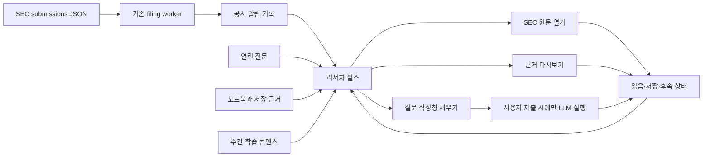

# PRD: 리서치 펄스 피드

## 문서 상태

- 상태: 구현 전 제안
- 작성일: 2026-07-15
- 대상 제품: KRW.O 웹 앱
- 제안 라우트: `/pulse`
- MVP 원칙: 기존 데이터 재조합, 백그라운드 LLM 없음, 새 생성 워커 없음
- 핵심 결과 지표: 첫 유효 공시 이후 `next-event retention`과 주간 재방문

## 1. 개요

리서치 펄스는 사용자가 먼저 질문하지 않아도 관심기업의 새 공시, 남아 있는
리서치 질문, 오래된 노트와 저장 근거, 정기 교육 콘텐츠를 하나의 시간순 피드에서
발견하도록 만드는 선제적 리서치 홈이다.

사용자가 느껴야 하는 핵심 경험은 “내가 없는 동안 새로운 조사거리가 준비됐다”이다.
그러나 무작위 질문과 답변을 대량 생성하거나 무한 스크롤로 체류시간을 늘리는 것이
목적은 아니다. 각 카드에는 반드시 실제 트리거, 표시 이유, 다음 행동과 원문 경로가
있어야 한다.

MVP는 현재 존재하는 다음 소스를 통합한다.

- `user_filing_notifications`: 결정론적 8-K·6-K 공시 알림과 사용자 처리 상태
- `sec_filing_events`: SEC 공시 메타데이터, Item 및 규칙 기반 사건 분류
- `user_company_questions.visible_after_at`: 이미 예약된 열린 질문 drip
- `user_company_notebooks`: 비어 있거나 오래된 기업별 노트북 상태
- `user_research_notes` 및 근거 연결: 과거에 저장한 리서치 내용
- 코드에 버전 관리되는 주간 학습·4컷 콘텐츠

## 2. 이번 계획에서 고정하는 제품 결정

### 2.1 라우트

새 화면은 `/pulse`에 만든다.

현재 `/discover`는 `stock_discovery` 권한과 “조건으로 기업 검색” 내비게이션에
연결돼 있으므로 바로 덮어쓰지 않는다. 향후 기존 기업 발견 기능을 폐기하거나
이동하기로 명시적으로 결정한 뒤에만 `/discover` 리다이렉트를 검토한다.

### 2.2 피드의 성격

- 최신순 무한 SNS 피드가 아니라 우선순위가 있는 유한 리서치 큐다.
- 첫 페이지는 최대 20개, 사용자가 눌러야 다음 페이지를 불러온다.
- 당일 항목을 다 보면 `오늘은 여기까지` 종료 상태를 보여준다.
- 새 공시가 없다는 사실도 정상 상태다. 콘텐츠 수를 맞추려고 사건을 생성하지 않는다.
- 모든 카드에 `왜 보이나요?`를 표시하거나 접근 가능한 설명으로 제공한다.

### 2.3 LLM 경계

- 새 8-K·6-K 감지, 분류, 우선순위, 공시 카드 생성에는 LLM을 사용하지 않는다.
- 데일리 체크업, 질문 노출, 근거 다시보기, 학습 카드 노출에도 LLM을 사용하지 않는다.
- 질문 카드의 `답변 만들기`는 채팅 작성창을 채울 뿐 자동 제출하지 않는다.
- 사용자가 직접 질문을 제출한 뒤에만 기존 채팅/에이전트 경로가 실행된다.
- 예약 AI 리서치는 MVP 밖이며, 추후 사용자가 명시적으로 켠 구독형 작업으로만 추가한다.

### 2.4 기술 접근

MVP는 별도의 `pulse_feed_items` 영속 테이블이나 전용 생성 워커를 만들지 않는다.
각 소스에서 상위 후보를 병렬 조회한 뒤 서버에서 공통 계약으로 변환하고 정렬하는
`federated read model`을 사용한다.

새 DB 저장은 소스 데이터가 아니라 다음 두 가지로 제한한다.

1. 사용자 피드 환경설정
2. 여러 소스에 공통으로 필요한 읽음·저장·숨김·피드백 상태

## 3. 해결하려는 문제

### 사용자 문제

- 사용자는 무엇을 질문해야 할지 몰라 채팅을 시작하지 못한다.
- 공시 알림, 공시함, 노트북, 질문이 서로 다른 화면에 있어 다음 행동이 끊긴다.
- 새 공시가 드문 기간에는 제품에 다시 들어올 명확한 이유가 없다.
- 과거에 저장한 근거와 생각이 쌓이지만 적절한 시점에 다시 보이지 않는다.

### 제품 문제

- 공시 감지와 푸시는 구현되어 있지만, 공시 이후 질문·저장·재검토로 이어지는
  하나의 반복 루프가 없다.
- 일반 D7만으로는 사건 발생형 공시 제품의 가치를 측정하기 어렵다.
- 자동 생성량을 늘리면 비용과 신뢰 문제가 생기지만, 아무것도 만들지 않으면
  추적 CIK가 적은 사용자의 피드가 비어 보일 수 있다.

## 4. 목표

### 제품 목표

- 사용자가 앱을 열었을 때 5초 안에 가장 중요한 다음 행동을 이해한다.
- 새 공시를 원문 열기, 질문 시작, 근거 저장으로 자연스럽게 연결한다.
- 새 사건이 없는 날에는 과거 질문과 근거를 재노출해 리서치 연속성을 만든다.
- 사용자가 피드 종류와 빈도를 직접 조절할 수 있게 한다.
- 기존 공시 알림의 결정론적 신뢰성과 낮은 운영비를 유지한다.

### 측정 가능한 초기 목표

출시 전 실제 기준값을 기록한 뒤 목표 효과 크기를 확정한다. 기준값이 없는 상태에서
절대 수치를 약속하지 않는다. 초기 판정은 다음 방향성으로 한다.

- 첫 공시를 연 사용자 중 두 번째 유효 공시도 여는 비율 증가
- 적격 사용자 중 7일 안에 서로 다른 2일 이상 `/pulse`를 연 비율 증가
- 피드 노출 후 SEC 원문 또는 기존 근거를 연 비율 증가
- 공시 카드에서 질문 작성창까지 이동한 비율 증가
- 보호 지표인 푸시 해제율, 공시 구독 해제율, SEC 원문 열기율 악화 없음
- MVP의 피드 노출당 LLM 비용 0원

## 5. 비목표

- 매수·매도 추천이나 수익률 예측
- 모든 금융 뉴스와 시장 속보를 모으는 일반 뉴스피드
- 인기도, 좋아요 수, 바이럴 점수 기반 정렬
- 백그라운드에서 모든 공시를 LLM으로 요약
- 사용자별 무작위 질문·답변 대량 생성
- 무한 자동 로딩 또는 체류시간 극대화
- MVP에서 이메일 뉴스레터, Slack, SMS 등 새 외부 전송 채널 추가
- MVP에서 콘텐츠 관리 시스템 구축
- 기존 `/filings`, `/watchlist`, `/discover` 제거
- 4컷 만화의 사용자별 실시간 생성

## 6. 대상 사용자와 권한

### 1차 대상

- 하나 이상의 기업 공시를 구독한 로그인 사용자
- 관심기업 또는 보유기업을 저장한 사용자
- 하나 이상의 열린 질문, 노트북 또는 저장 근거가 있는 사용자

### 신규 사용자

개인화 근거가 없을 때 가짜 피드를 만들지 않는다. 다음 온보딩 상태를 제공한다.

1. 관심기업 3개 선택
2. 기업별 공시 알림 켜기
3. 예시 학습 카드 한 건 보기

### 플랜별 노출

- 공시 LIVE, 데일리 체크업의 공시 부분, 학습 콘텐츠는 모든 로그인 사용자에게 노출한다.
- 질문·노트북·저장 근거는 현재 `research_notebook` 권한이 활성화된 사용자에게만 노출한다.
- 권한이 없는 사용자에게 잠긴 카드가 반복 노출되지 않도록 해당 소스 자체를 합성에서 제외한다.
- MVP 피드를 새 유료 기능으로 정의하지 않는다. 먼저 리텐션 표면으로 검증한다.

## 7. 핵심 사용자 흐름



## 8. 정보 구조

### 상단 내비게이션

- 새 1순위 항목: `오늘`
- 목적지: `/pulse`
- 읽지 않은 긴급·일반 공시가 있을 때만 숫자 배지 표시
- `/filings`는 `공시 알림`으로 유지
- `/watchlist`는 `리서치 노트북`으로 유지
- `/discover`는 `조건으로 기업 검색`으로 유지

### 피드 필터

URL 쿼리로 유지해 새로고침과 뒤로 가기를 지원한다.

```text
/pulse
/pulse?kind=filing
/pulse?kind=checkup
/pulse?kind=question
/pulse?kind=resurface
/pulse?kind=learning
```

표시 라벨:

```text
[전체] [공시] [체크업] [질문] [다시보기] [배우기]
```

### 보조 화면

- `/pulse/settings`: 피드 종류, 빈도, 시간대 설정
- 상세 원문과 감사 가능한 처리 상태: 기존 `/filings`
- 장기 노트와 질문 관리: 기존 `/watchlist`
- 실제 답변 생성: 기존 `/chat/new` 또는 현재 채팅 작성 경로

## 9. 피드 종류와 정확한 트리거

### 9.1 공시 LIVE

**소스**

- `user_filing_notifications.kind = 'filing_received'`
- 연결된 `sec_filing_events`
- 기존 사용자 구독과 `display_ticker`

**노출 조건**

- 사용자 소유 알림이다.
- `archived_at is null`이다.
- `snoozed_until`이 없거나 현재보다 과거다.
- 90일 보존 기간 안에 있다.

**우선순위**

- `alert_priority = urgent`: 최상단, 종목 다양성 제한 면제
- `normal`: 긴급 다음
- `digest`: 나머지 리서치 카드와 섞되 최신성 우선

**카드 필드**

- 종목, 양식, 정정 여부, 제출 시각
- 규칙 기반 사건 라벨 또는 SEC Item
- `왜 보이나요?`: “이 기업의 공시 알림을 켰기 때문입니다.”
- CTA: `공시 보기`, `SEC 원문`, `나중에`, `질문하기`

**중복 처리**

- 같은 CIK에서 10분 안에 제출된 일반 공시는 한 스택으로 표시한다.
- 긴급 공시는 스택에 묶지 않는다.
- 기존 `filing_digest` 알림은 펄스의 개별 카드와 중복되므로 기본 피드에서 제외하고
  데일리 체크업의 개수 계산에만 사용한다.

### 9.2 데일리 체크업

**트리거**

- 사용자 시간대 기준 설정 시각 이후 하루 한 번 합성한다.
- 기본 시간: `08:30`
- item key: `checkup:{local-date}`

**데이터**

- 지난 체크업 이후 새 공시 수
- 아직 읽지 않은 공시 수
- 지금 노출 가능한 열린 질문 수
- 30일 이상 갱신되지 않은 노트북 수

**행동**

- `처리할 공시 보기`
- `열린 질문 보기`
- `오늘은 됐어요`로 당일 숨김

**규칙**

- 네 값이 모두 0이면 체크업 카드를 생성하지 않는다.
- 기존 일간 공시 digest의 푸시 전송과 피드 체크업은 별도 개념이다.
- 피드 체크업 때문에 새 푸시를 만들지 않는다.

### 9.3 후속 질문

**소스**

- `user_company_questions`

**노출 조건**

- `status = 'open'`
- `visible_after_at <= now()`
- 사용자가 `research_notebook`에 접근 가능
- 해당 item key가 숨김 또는 미래 snooze 상태가 아님

**규칙**

- 기존 `visible_after_at` drip을 그대로 사용한다.
- MVP 피드를 위해 새 질문을 생성하지 않는다.
- 동일 종목 질문은 첫 화면에 최대 한 개만 노출한다.
- `답변 만들기`는 `ticker`와 `query`를 채운 채팅 작성 화면으로 이동하되 자동 제출하지 않는다.
- `관심 없음`은 원본 질문 상태를 `dismissed`로 바꾸며 노트북 화면에도 동일하게 반영한다.

**표시 이유 예시**

- “저장한 대화에서 남은 질문입니다.”
- “이 질문의 공개 시각이 됐습니다.”
- 추후 공시 연결 기능이 생기면 “오늘 제출된 8-K Item 5.02와 연결된 질문입니다.”

### 9.4 근거 다시보기

**MVP 후보 소스**

- `user_research_notes`
- `user_company_notebooks`

**노출 기준**

- 14일 이상 지난 노트 또는 30일 이상 갱신되지 않은 비어 있지 않은 노트북
- 사용자 소유이며 접근 권한이 있음
- 같은 소스는 28일 안에 다시 노출하지 않음
- 한 사용자에게 하루 최대 한 건

**선택 방법**

- 무작위 함수를 사용하지 않는다.
- 적격 후보를 오래된 순으로 정렬한다.
- 동률은 `hash(user_id + ISO week + source_id)`로 결정해 같은 주에는 안정적으로 유지한다.
- item key: `resurface:{source-type}:{source-id}:{iso-week}`

**행동**

- `원문 다시 보기`
- `여전히 중요함`: 저장 상태 유지 및 다음 노출을 28일 뒤로 연기
- `이제 중요하지 않음`: 해당 재노출만 영구 숨김. 원본 노트는 삭제하지 않음

### 9.5 주간 배우기 및 4컷

**MVP 저장 방식**

- `src/content/pulse/learning.ts`의 버전 관리된 정적 manifest
- 이미지: `public/pulse/learning/{slug}.webp`
- 사용자별 이미지 생성 없음

**콘텐츠 계약**

- `slug`, `version`, `title`, `dek`, `format`, `publishAt`, `expiresAt`
- `sourceLinks[]`, `relatedFilingEventTag`, `imagePath`, `alt`
- `format`: `explainer | four_panel | checklist`

**노출 규칙**

- 주 1건 이하
- 첫 10개 카드 안에 최대 한 건
- 긴급 공시보다 항상 아래
- 출처가 없는 콘텐츠는 빌드 검증에서 실패
- 실시간 공시·실적을 자동으로 풍자하지 않음
- 매수·매도 결론, 실제 손실 조롱, 인물 비방 금지

### 9.6 사용자 구독형 AI 리서치 작업 — MVP 이후

이 종류만 LLM을 사용할 수 있다.

**필수 조건**

- 사용자가 주제와 빈도를 직접 만들고 켠다.
- 기본값은 off다.
- 실행 전 권한 및 크레딧/비용 한도를 확인한다.
- 동일 스케줄·기간은 idempotency key로 한 번만 실행한다.
- 결과 카드에 `AI 생성`, 실행 시각, 사용한 근거와 출처를 표시한다.
- 사용자가 끄면 다음 작업이 예약되지 않는다.
- 이 결과는 공시의 규칙 분류나 알림 우선순위를 변경하지 않는다.

## 10. 공통 피드 아이템 계약

```ts
type PulseItemKind =
  | "filing"
  | "checkup"
  | "question"
  | "resurface"
  | "learning"
  | "research_task";

type PulseTrigger = "event" | "schedule" | "state" | "editorial" | "user_task";

interface PulseItem {
  id: string;                 // 클라이언트용 opaque id
  itemKey: string;            // 서버에서만 해석하는 안정 키
  kind: PulseItemKind;
  trigger: PulseTrigger;
  sourceType: string;
  sourceId: string | null;
  ticker: string | null;
  title: string;
  body: string | null;
  reasonCode: string;
  reasonLabel: string;
  priority: number;
  occurredAt: string;
  availableAt: string;
  expiresAt: string | null;
  readAt: string | null;
  savedAt: string | null;
  snoozedUntil: string | null;
  groupKey: string | null;
  primaryAction: PulseAction;
  secondaryActions: PulseAction[];
  metadata: Record<string, string | number | boolean | null>;
}
```

클라이언트가 임의의 `itemKey`, `sourceId`, 목적지 URL을 신뢰 경계 밖에서 조작하지
못하도록, mutation API는 prefix를 검증하고 소스 레코드의 사용자 소유권을 다시 확인한다.

## 11. 정렬, 다양성, 피로도 규칙

MVP 정렬은 머신러닝 없이 결정론적으로 계산한다.

### 기본 점수

| 항목 | 기본 점수 |
|---|---:|
| 긴급 공시 | 1000 |
| 일반 공시 | 900 |
| 사용자가 구독한 AI 작업 결과 | 850 |
| digest 등급 공시 | 760 |
| 후속 질문 | 700 |
| 데일리 체크업 | 650 |
| 근거 다시보기 | 500 |
| 학습·4컷 | 300 |

### 보정

- 읽지 않음: `+40`
- 핀 된 기존 공시: `+60`
- 현재 보유기업: `+20`
- 최신성: 종류별 최대 `+50`, 시간 경과에 따라 선형 감소
- 동일 item을 이번 주에 두 번 이상 봄: 회당 `-25`
- 사용자가 해당 종류에 부정 피드백: 다음 14일 `-80`

### 다양성 제한

- 첫 8개 안에 동일 ticker 최대 2개. 긴급 공시는 예외다.
- 첫 10개 안에 learning 최대 1개다.
- 동일 질문·동일 노트 소스는 한 번만 포함한다.
- 체크업 수치에 포함된 개별 공시는 피드에서 그대로 보일 수 있지만,
  체크업 문구가 개별 내용을 반복 요약하지 않도록 한다.

### 안정적인 페이지네이션

- 정렬 결과의 `rankedAt`과 `itemKey`를 cursor로 사용한다.
- 같은 요청 안에서는 `occurredAt`, `itemKey`를 최종 tie-breaker로 사용한다.
- cursor는 base64url JSON으로 인코딩하고 Zod로 검증한다.
- 변조된 cursor는 400을 반환하며 권한에는 영향을 주지 않는다.

## 12. 데이터 모델

### 12.1 `user_pulse_preferences`

| 컬럼 | 타입 | 기본값/제약 |
|---|---|---|
| `user_id` | uuid PK/FK | auth.users, cascade |
| `enabled_kinds` | text[] | filing/checkup/question/resurface/learning |
| `daily_checkup_enabled` | boolean | true |
| `daily_checkup_at` | time | 08:30 |
| `timezone` | text | Asia/Seoul |
| `question_cadence` | text | daily, three_weekly, off |
| `resurface_cadence` | text | weekly, biweekly, off |
| `learning_cadence` | text | weekly, off |
| `created_at` | timestamptz | now() |
| `updated_at` | timestamptz | now() |

제약:

- 허용하지 않는 `enabled_kinds` 값 거부
- 유효한 cadence 값만 허용
- RLS로 본인 행만 select/insert/update
- 삭제 대신 기본값으로 reset하는 API 제공

### 12.2 `user_pulse_item_states`

| 컬럼 | 타입 | 설명 |
|---|---|---|
| `user_id` | uuid | 소유자 |
| `item_key` | text | 안정적인 소스 기반 키 |
| `kind` | text | 공통 종류 |
| `source_type` | text | filing_notification 등 |
| `source_id` | text nullable | 원본 id |
| `first_seen_at` | timestamptz | 첫 feed 응답 포함 시각 |
| `last_seen_at` | timestamptz | 마지막 실제 impression 시각 |
| `view_count` | integer | 0 이상 |
| `read_at` | timestamptz nullable | 읽음 |
| `saved_at` | timestamptz nullable | 저장 |
| `dismissed_at` | timestamptz nullable | 숨김 |
| `snoozed_until` | timestamptz nullable | 나중에 보기 |
| `feedback` | smallint nullable | -1 또는 1 |
| `created_at` | timestamptz | 생성 |
| `updated_at` | timestamptz | 갱신 |

키와 인덱스:

- PK `(user_id, item_key)`
- 활성 상태 조회용 `(user_id, dismissed_at, snoozed_until, updated_at desc)`
- `source_type, source_id` 조회 인덱스
- `item_key` 최대 240자
- `view_count >= 0`, `feedback in (-1, 1)`

### 12.3 만들지 않는 테이블

MVP에서는 `pulse_feed_items`를 만들지 않는다. 다음 조건 중 하나가 실제로 발생하면
materialized feed로 전환을 검토한다.

- 피드 GET p95가 500ms를 지속적으로 초과
- 사용자당 후보가 1,000개를 넘어 pagination 재계산 비용이 커짐
- feed item 자체를 push/email로 전송해야 함
- 여러 생성 작업이 동일 카드 snapshot을 공유해야 함

## 13. 서버 합성 구조

제안 파일:

```text
src/lib/pulse/
  contract.ts
  composer.ts
  ranking.ts
  cursor.ts
  preferences.ts
  item-state.ts
  sources/
    filings.ts
    checkup.ts
    questions.ts
    resurface.ts
    learning.ts
```

`composePulseFeed()`는 `Promise.allSettled`로 각 소스를 병렬 조회한다.

```text
각 source에서 최대 50개 후보 조회
  → 공통 PulseItem 후보로 변환
  → 사용자 state 병합
  → 숨김/snooze/만료 필터
  → 그룹화와 중복 제거
  → 결정론 점수 계산
  → 종목·콘텐츠 다양성 적용
  → cursor 이후 20개 반환
```

한 소스가 실패해도 전체 피드를 500으로 만들지 않는다. 응답에 내부 관찰용
`degradedSources`를 포함하고, UI는 남은 항목을 표시한다. 인증과 공통 DB 연결이
실패한 경우에만 전체 503을 반환한다.

## 14. API 계약

### `GET /api/pulse`

쿼리:

- `kind`: all 또는 단일 허용 종류
- `limit`: 기본 20, 최대 30
- `cursor`: 선택
- `since`: 새 항목 확인용 ISO timestamp, 선택

응답:

```json
{
  "items": [],
  "next_cursor": null,
  "new_count": 0,
  "counts_by_kind": {
    "filing": 0,
    "checkup": 0,
    "question": 0,
    "resurface": 0,
    "learning": 0
  },
  "generated_at": "2026-07-15T00:00:00.000Z"
}
```

요구사항:

- 로그인 필수
- `Cache-Control: private, no-store`
- source별 N+1 쿼리 금지
- 응답 payload 목표 100KB 이하
- 허용되지 않은 kind/cursor는 400

### `PATCH /api/pulse/items/[itemId]`

요청:

```json
{
  "action": "read | save | dismiss | snooze | feedback",
  "value": true
}
```

규칙:

- mutation origin 검증
- item id 형식 검증
- 원본 소스에 대한 사용자 소유권 재검증
- filing의 read/snooze는 기존 `user_filing_notifications` 상태도 함께 갱신
- question dismiss는 원본 질문을 `dismissed`로 갱신
- resurface dismiss는 원본 노트를 삭제하지 않고 pulse state만 갱신
- 동일 요청 재전송이 안전한 idempotent update

### `GET/PATCH /api/pulse/preferences`

- 로그인 및 origin 검증
- timezone은 `Intl.DateTimeFormat`에서 유효한 IANA timezone만 허용
- 종류를 끄더라도 원본 공시 구독·노트·질문을 삭제하지 않음
- 공시 push 설정은 기존 알림 설정 화면에서 계속 관리

## 15. 화면 상세

### 헤더

```text
오늘
7월 15일 수요일 · 새로 준비된 항목 4개
                                     [맞춤 설정]
```

- `Pulse`라는 외부 제품명을 그대로 복제하기보다 사용자 언어인 `오늘`을 1차 라벨로 사용한다.
- 내부 기능명과 분석 이벤트에서는 `pulse`를 사용할 수 있다.

### 카드 공통 구조

1. 종류와 시간: `LIVE · 12분 전`
2. 종목/출처 메타데이터
3. 제목
4. 한두 줄 본문
5. 접을 수 있는 `왜 보이나요?`
6. 1개 primary CTA, 최대 3개 secondary action

### 카드별 시각 위계

- 긴급 공시: 왼쪽 accent와 `긴급` 텍스트, 색상만으로 상태를 전달하지 않음
- 일반 공시: 기본 surface
- 질문: 질문부호 아이콘보다 실제 질문 문장을 크게 표시
- 다시보기: 과거 시각과 원문 출처를 전면 표시
- 학습·4컷: 이미지 비중을 높이되 `교육용` 라벨과 출처를 표시

### 새 항목 갱신

- 탭이 보이는 동안 60초마다 `since` 요청
- `document.visibilityState !== 'visible'`이면 polling 중단
- 다시 visible이 되면 즉시 한 번 확인
- 새 항목이 있으면 목록을 강제로 움직이지 않고 `새 항목 N개` pill 표시
- 사용자가 pill을 누를 때만 상단에 병합하고 초점을 유지
- reduced motion 사용자는 삽입 애니메이션 없음

### 빈 상태

#### 개인화 정보가 전혀 없음

- “관심기업을 추가하면 새 공시와 후속 질문이 여기에 준비됩니다.”
- `기업 찾기`, `공시 알림 설정` CTA
- 학습 예시 최대 한 건

#### 오늘 새 항목이 없음

- “오늘은 새로 확인할 항목이 없습니다.”
- 마지막 동기화 시각
- `/filings`, `/watchlist` 바로가기

#### 필터 결과 없음

- 현재 필터를 명시
- `전체 보기` CTA

### 페이지 끝

- `오늘은 여기까지`
- 자동으로 다음 페이지를 불러오지 않음
- 사용자가 명시적으로 `이전 항목 더 보기`를 누를 때만 cursor 요청

## 16. 분석 이벤트

기존 1st-party `analytics_events` 제약과 TypeScript 이벤트 목록을 함께 확장한다.

### 이벤트

- `pulse_viewed`
- `pulse_item_impression`
- `pulse_item_opened`
- `pulse_item_actioned`
- `pulse_filter_changed`
- `pulse_preferences_updated`
- `pulse_new_items_seen`
- `pulse_end_reached`
- `pulse_feedback_submitted`
- `pulse_source_degraded`
- `pulse_answer_prefilled`

### 공통 properties

- `feed_session_id`
- `item_kind`
- `source_type`
- `trigger`
- `reason_code`
- `ticker` 가능한 경우
- `rank`
- `is_read`
- `age_seconds`
- `surface = pulse`

### impression 규칙

- 카드가 viewport의 50% 이상에서 1초 이상 보일 때 한 번 기록
- 같은 `feed_session_id + item_id`는 중복 기록하지 않음
- 목록 렌더만으로 impression을 기록하지 않음

### 핵심 지표 정의

1. `pulse weekly return`
   - 적격 사용자가 첫 `/pulse` 방문 후 7일 안에 서로 다른 2일 이상 방문
2. `next-event retention`
   - 첫 고유 filing event를 연 사용자가 다음 고유 유효 filing event도 엶
3. `feed-to-source open rate`
   - `pulse_item_opened / pulse_item_impression`
4. `question start rate`
   - `pulse_answer_prefilled / question impression`
5. `evidence revisit rate`
   - 다시보기 원문 open / resurface impression

### 보호 지표

- `push_unsubscribed`
- `filing_subscription_removed`
- 공시 카드의 SEC 원문 열기율
- 부정 피드백률
- 동일 카드 반복 노출률
- API p95 및 source degraded 비율
- MVP LLM 비용

## 17. 보안과 개인정보

- 모든 피드 API는 인증을 요구한다.
- service-role 조회 시에도 모든 source 쿼리에 `user_id` 조건을 강제한다.
- item mutation은 source ownership을 다시 확인한다.
- 정적 학습 콘텐츠를 제외한 개인 피드는 공유 URL을 제공하지 않는다.
- 공시 문서 전문은 새로 저장하지 않는다.
- 다시보기 카드는 사용자의 노트 제목과 짧은 preview만 전송하며 100KB 노트 전체를 목록에 싣지 않는다.
- 사용자 피드백은 해당 사용자 개인화와 제품 분석에만 사용한다.
- analytics properties에 질문 전문, 노트 전문, 공시 문서 본문을 넣지 않는다.

## 18. 성능과 비용 예산

### MVP 비용 원칙

- 피드 합성 자체의 LLM 호출: 0
- 이미지 생성: 0. 4컷은 사전 제작 자산 재사용
- 새 외부 SaaS: 0
- 새 상시 worker: 0

### 조회 예산

- source당 후보 최대 50개
- 최종 응답 최대 30개
- source 쿼리 병렬 실행
- 쿼리 수 목표: 기본 사용자 6개 이하
- GET API p95 목표: 초기 규모에서 500ms 이하
- 클라이언트 payload 목표: 100KB 이하
- background polling: visible tab에서만 60초

### materialization 전환 기준

섹션 12.3의 조건이 발생하면 `pulse_feed_items`와 별도 fan-out/outbox를 설계한다.
그 전에는 운영 복잡성을 추가하지 않는다.

## 19. 접근성, 반응형, 국제화

- 각 카드는 `article` 또는 동등한 의미 구조를 사용한다.
- 필터는 키보드로 이동 가능하고 현재 선택을 `aria-selected`로 전달한다.
- 새 항목 pill이 나타나도 자동으로 포커스를 이동하지 않는다.
- 긴급·읽음 상태는 색상 외 텍스트/아이콘으로도 전달한다.
- CTA touch target 최소 44px.
- 모바일에서는 secondary action을 overflow menu로 축약하되 primary action은 유지한다.
- 모든 이미지에 정보성 alt를 제공한다. 4컷의 핵심 내용은 텍스트 요약으로도 제공한다.
- 날짜와 시간은 현재 locale과 사용자 timezone으로 표시한다.
- 한국어를 먼저 구현하되 모든 계약 문자열은 컴포넌트 밖 copy map으로 분리한다.
- `prefers-reduced-motion`을 존중한다.

## 20. 단계별 구현 계획

### Phase 0 — 계약과 기준값

범위:

- 출시 전 기준 지표 쿼리 확정
- `PulseItem` discriminated union과 reason code 정의
- route와 내비게이션 명칭 확정
- feature flags 추가

완료 조건:

- 모든 item kind의 예시 fixture 존재
- ranking 입력/출력 계약 승인
- 현재 next-event retention 기준값 문서화
- `PULSE_FEED_ENABLED=0`에서 기존 앱 동작 변화 없음

### Phase 1 — 읽기 전용 MVP

범위:

- `/pulse`
- filing, checkup, question source adapter
- composer, ranking, dedupe, cursor
- `GET /api/pulse`
- 필터와 기본 카드
- 읽기 전용 analytics

완료 조건:

- 기존 공시와 열린 질문이 하나의 목록에 안정적으로 표시
- 공시 LIVE는 LLM을 호출하지 않음
- 동일 CIK 10분 묶음과 urgent 예외 테스트 통과
- 데스크톱·모바일 브라우저 검증

### Phase 2 — 상태와 다시보기

범위:

- preferences 및 item state migration
- read/save/dismiss/snooze/feedback API
- source mutation 동기화
- resurface source
- 새 항목 polling과 pill

완료 조건:

- Pulse에서 읽음/나중에/질문 dismiss가 원본 화면에도 반영
- 같은 근거가 28일 안에 다시 나오지 않음
- polling이 background tab에서 멈춤
- source 하나가 실패해도 부분 피드 제공

### Phase 3 — 주간 학습과 4컷

범위:

- 정적 콘텐츠 manifest와 validation
- learning/four-panel card
- 출처·alt·텍스트 요약 검증
- 첫 주 실험 1건

완료 조건:

- 사용자별 생성 비용 없음
- 주 1건, 첫 10개 최대 1건 제한 통과
- 출처 없는 항목은 테스트/빌드 실패
- 공시 원문 열기율을 잠식하지 않는지 별도 측정

### Phase 4 — 선택적 예약 리서치

이전 단계에서 feed return과 source open 개선이 확인될 때만 시작한다.

범위:

- 사용자가 만드는 schedule
- 명시적 크레딧/비용 경계
- idempotent agent run
- AI 생성 라벨과 출처

완료 조건:

- 기본 off
- 사용자가 끄면 추가 실행 없음
- 실패한 작업이 빈/허위 카드로 노출되지 않음
- 공시 알림 경로와 코드 의존성이 분리됨

## 21. 사용자 스토리와 수용 기준

### US-001: 공통 피드 계약 정의

**설명:** 개발자로서 모든 소스를 한 화면에서 안전하게 렌더할 수 있도록 공통 계약이 필요하다.

**수용 기준:**

- [ ] 각 kind는 TypeScript discriminated union으로 구분된다.
- [ ] 모든 kind가 `reasonCode`, `reasonLabel`, `availableAt`, action을 가진다.
- [ ] 잘못된 item fixture가 Zod 검증에 실패한다.
- [ ] typecheck와 unit test가 통과한다.

### US-002: 피드 설정 및 상태 저장

**설명:** 사용자로서 읽음·숨김·빈도 설정이 다음 방문에도 유지되길 원한다.

**수용 기준:**

- [ ] additive migration으로 두 테이블이 생성된다.
- [ ] RLS가 본인 행만 허용한다.
- [ ] PK와 활성 조회 인덱스가 존재한다.
- [ ] 허용하지 않는 kind/cadence/feedback가 DB 제약에서 거부된다.
- [ ] migration smoke test가 통과한다.

### US-003: 공시 소스 어댑터

**설명:** 공시 구독자로서 기존 공시함의 새 사건을 펄스에서도 보고 싶다.

**수용 기준:**

- [ ] 본인 알림만 조회한다.
- [ ] archive와 미래 snooze 항목을 제외한다.
- [ ] alert priority와 사건 라벨을 유지한다.
- [ ] filing digest 중복 카드를 제외한다.
- [ ] 같은 CIK의 10분 묶음과 urgent 예외를 검증한다.
- [ ] 어댑터가 LLM/agent 모듈을 import하지 않는다.

### US-004: 데일리 체크업 어댑터

**설명:** 사용자로서 매일 처리할 공시와 질문의 규모를 한 장에서 알고 싶다.

**수용 기준:**

- [ ] 사용자 timezone 기준 하루 하나의 안정 item key를 만든다.
- [ ] 설정 시각 전에는 노출하지 않는다.
- [ ] 모든 count가 0이면 카드를 만들지 않는다.
- [ ] 같은 날 재요청해도 중복 카드를 만들지 않는다.
- [ ] DST와 timezone unit test가 통과한다.

### US-005: 질문 소스 어댑터

**설명:** 사용자로서 공개 시각이 된 열린 질문을 피드에서 발견하고 이어서 답하고 싶다.

**수용 기준:**

- [ ] open이고 `visible_after_at <= now()`인 질문만 표시한다.
- [ ] 종목당 첫 화면 최대 한 질문을 적용한다.
- [ ] 권한이 없으면 질문 내용을 응답하지 않는다.
- [ ] 답변 CTA는 작성창만 채우고 자동 실행하지 않는다.
- [ ] dismiss가 원본 질문 상태에도 반영된다.

### US-006: 근거 다시보기 어댑터

**설명:** 사용자로서 과거 근거가 잊히기 전에 적절한 간격으로 다시 보고 싶다.

**수용 기준:**

- [ ] 노트 14일, 노트북 30일 기준을 적용한다.
- [ ] 같은 source는 28일 내 재노출하지 않는다.
- [ ] 하루 최대 한 건이다.
- [ ] 선택이 사용자/주차 기준으로 결정론적이다.
- [ ] `이제 중요하지 않음`이 원본을 삭제하지 않는다.

### US-007: 합성 및 정렬

**설명:** 사용자로서 가장 중요한 사건을 먼저 보되 한 종목이나 교육 콘텐츠에 피드가 잠식되지 않길 원한다.

**수용 기준:**

- [ ] 긴급 공시가 항상 비긴급보다 앞선다.
- [ ] 첫 8개 동일 ticker 2개 제한이 동작한다.
- [ ] 첫 10개 learning 1개 제한이 동작한다.
- [ ] tie-break가 안정적이다.
- [ ] source failure가 다른 source 결과를 제거하지 않는다.
- [ ] 1,000개 fixture에서 정렬 unit test가 합리적인 시간 안에 끝난다.

### US-008: 피드 조회 API

**설명:** 클라이언트로서 필터와 cursor를 사용해 안정적으로 피드를 읽고 싶다.

**수용 기준:**

- [ ] 미인증 요청은 401이다.
- [ ] kind/limit/cursor를 Zod로 검증한다.
- [ ] limit은 30을 초과할 수 없다.
- [ ] 응답은 private/no-store다.
- [ ] pagination에서 중복/누락 fixture 테스트가 통과한다.
- [ ] API route test가 통과한다.

### US-009: 피드 action API

**설명:** 사용자로서 카드 상태를 바꾸고 모든 관련 화면에서 동일하게 보고 싶다.

**수용 기준:**

- [ ] mutation origin을 검증한다.
- [ ] 다른 사용자의 item을 변경할 수 없다.
- [ ] 같은 action 재전송이 안전하다.
- [ ] filing read/snooze가 기존 공시함에 반영된다.
- [ ] question dismiss가 노트북에 반영된다.
- [ ] resurface dismiss가 원본 노트를 보존한다.

### US-010: 피드 환경설정 API와 화면

**설명:** 사용자로서 어떤 종류가 얼마나 자주 보이는지 조절하고 싶다.

**수용 기준:**

- [ ] 종류별 on/off를 저장한다.
- [ ] 체크업 시간과 timezone을 저장한다.
- [ ] 공시 push 설정과 혼동되지 않는 설명을 제공한다.
- [ ] 모든 종류를 꺼도 원본 데이터는 삭제되지 않는다.
- [ ] 브라우저에서 키보드와 모바일로 검증한다.

### US-011: `/pulse` 페이지 셸

**설명:** 사용자로서 로그인 후 오늘 준비된 리서치를 한 화면에서 보고 싶다.

**수용 기준:**

- [ ] 미인증 사용자는 `/login?next=/pulse`로 이동한다.
- [ ] server-rendered 초기 feed가 있다.
- [ ] 상단 내비게이션에 `오늘` 항목이 feature flag 뒤에 나타난다.
- [ ] `/discover`, `/filings`, `/watchlist`의 기존 의미가 유지된다.
- [ ] loading/error/empty/end 상태가 모두 존재한다.
- [ ] 브라우저에서 데스크톱과 모바일을 검증한다.

### US-012: 종류별 카드

**설명:** 사용자로서 카드 종류와 다음 행동을 스캔만으로 이해하고 싶다.

**수용 기준:**

- [ ] 카드마다 trigger/시간/이유/primary action이 보인다.
- [ ] 긴급은 색상 외 텍스트로도 표시된다.
- [ ] secondary action은 최대 3개다.
- [ ] 4컷은 alt와 텍스트 요약을 제공한다.
- [ ] focus order와 screen reader label을 검증한다.
- [ ] 브라우저에서 검증한다.

### US-013: 새 항목 감지

**설명:** 사용자로서 읽는 도중 목록 위치를 잃지 않고 새 공시 도착을 알고 싶다.

**수용 기준:**

- [ ] visible tab에서만 60초 polling한다.
- [ ] 다시 visible이 되면 즉시 확인한다.
- [ ] 새 항목이 있어도 자동 삽입하지 않는다.
- [ ] pill 클릭 시에만 병합한다.
- [ ] reduced motion에서 삽입 애니메이션이 없다.
- [ ] 브라우저에서 검증한다.

### US-014: 주간 학습 및 4컷

**설명:** 사용자로서 어려운 공시 개념을 가볍게 이해하고 실제 근거로 이어가고 싶다.

**수용 기준:**

- [ ] manifest schema validation이 있다.
- [ ] source link 없는 콘텐츠는 실패한다.
- [ ] 주 1개 및 first-10 제한이 동작한다.
- [ ] 사용자별 LLM/image generation을 실행하지 않는다.
- [ ] 실시간 공시 자동 풍자와 투자 지시를 금지하는 편집 체크리스트가 있다.

### US-015: 분석과 지표

**설명:** 제품 운영자로서 체류시간이 아니라 재방문과 근거 행동이 개선됐는지 알고 싶다.

**수용 기준:**

- [ ] DB analytics event check constraint와 TS 목록이 함께 갱신된다.
- [ ] impression은 50%/1초 규칙을 따른다.
- [ ] 같은 세션의 같은 item impression이 중복되지 않는다.
- [ ] next-event retention 쿼리가 문서화된다.
- [ ] LLM 비용이 MVP에서 항상 0으로 집계된다.

### US-016: 장애 격리와 관찰성

**설명:** 운영자로서 한 데이터 소스 장애가 전체 홈을 막지 않길 원한다.

**수용 기준:**

- [ ] source별 latency/error를 기록한다.
- [ ] `Promise.allSettled` 기반 부분 성공을 지원한다.
- [ ] 공통 인증/DB 장애만 전체 503이다.
- [ ] 내부 로그에 user content 전문을 기록하지 않는다.
- [ ] 장애 알림 기준이 운영 문서에 기록된다.

### US-017: LLM 경계 계약 테스트

**설명:** 사용자와 운영자로서 단순 피드 조회가 숨은 AI 비용을 만들지 않는다는 보장이 필요하다.

**수용 기준:**

- [ ] `src/lib/pulse`의 MVP 경로가 agent/LLM gateway를 import하지 않는다.
- [ ] GET `/api/pulse` 테스트에서 agent run, credit reservation, LLM gateway 호출이 0이다.
- [ ] 질문 CTA는 draft 상태까지만 만든다.
- [ ] filing worker의 기존 no-LLM contract test가 계속 통과한다.

## 22. 예상 파일 변경 지도

### 새 파일

```text
src/app/pulse/page.tsx
src/app/pulse/settings/page.tsx
src/app/api/pulse/route.ts
src/app/api/pulse/preferences/route.ts
src/app/api/pulse/items/[itemId]/route.ts
src/components/pulse/PulseFeedClient.tsx
src/components/pulse/PulseHeader.tsx
src/components/pulse/PulseFilters.tsx
src/components/pulse/PulseCard.tsx
src/components/pulse/cards/FilingPulseCard.tsx
src/components/pulse/cards/CheckupPulseCard.tsx
src/components/pulse/cards/QuestionPulseCard.tsx
src/components/pulse/cards/ResurfacePulseCard.tsx
src/components/pulse/cards/LearningPulseCard.tsx
src/lib/pulse/contract.ts
src/lib/pulse/composer.ts
src/lib/pulse/ranking.ts
src/lib/pulse/cursor.ts
src/lib/pulse/preferences.ts
src/lib/pulse/item-state.ts
src/lib/pulse/sources/*.ts
src/content/pulse/learning.ts
public/pulse/learning/*
supabase/migrations/<timestamp>_research_pulse_state.sql
supabase/migrations/<timestamp>_research_pulse_analytics.sql
docs/experiments/research-pulse.md
```

### 수정 가능성이 높은 기존 파일

```text
src/components/TopNav.tsx
src/components/AppShell.tsx
src/lib/analytics/events.ts
src/types/api-contracts.ts
src/types/database.ts
src/lib/billing/feature-access.ts
src/app/api/watchlist/[ticker]/questions/[questionId]/route.ts
```

### 수정하지 않아야 하는 핵심 경계

- `src/worker/filing-notification-worker.ts`의 공시 감지 핵심 로직
- `src/lib/filing-notifications/classification.ts`의 규칙 분류
- submissions JSON CIK polling 방식
- 기존 `/filings` 감사형 공시함의 원본 상태 의미

## 23. 테스트 계획

### 단위 테스트

- kind별 contract parsing
- 점수와 tie-break
- urgent 우선순위
- 동일 ticker 다양성 제한
- 10분 CIK grouping
- digest 제외
- visible_after_at 경계
- timezone 및 DST 체크업
- 14/30/28일 다시보기 경계
- deterministic weekly rotation
- static learning source validation
- cursor encode/decode와 invalid input
- LLM import/호출 경계

### API 테스트

- 미인증, 다른 사용자 소유권, invalid origin
- kind/filter/limit/cursor validation
- 부분 source 실패
- idempotent PATCH
- filing 상태 동기화
- question dismiss 동기화
- preference reset

### 마이그레이션 테스트

- 새 테이블/인덱스/constraint/RLS 존재
- analytics event constraint에 새 이벤트 포함
- service role 및 authenticated 권한 최소화
- 기존 migration 순서에서 clean apply

### 브라우저/E2E

- 개인화 정보 없는 신규 사용자
- 공시만 있는 사용자
- 공시·질문·노트가 모두 있는 사용자
- 새 항목 pill과 scroll 위치 유지
- filter URL persistence
- filing 상세/SEC source 이동
- question draft prefill 후 자동 제출되지 않음
- mobile action overflow
- keyboard와 reduced motion
- partial degraded state

### 회귀 테스트

- `/filings` read/pin/snooze/archive
- 기존 push 및 daily digest
- `/watchlist` 질문 dismiss
- `/discover` stock discovery
- plan feature split on/off

## 24. 출시 계획

### Gate 1: 개발 환경

- `PULSE_FEED_ENABLED=1`을 개발 환경에서만 설정
- seed fixtures로 모든 카드와 상태 확인
- full typecheck, lint, unit, 관련 E2E 통과

### Gate 2: 내부 dogfood

- internal 계정만 stable hash 또는 allowlist로 노출
- 최소 7일 동안 source 오류, 반복 카드, 정렬 문제 관찰
- 공시 알림 worker와 API latency에 변화가 없는지 확인

### Gate 3: 10% 읽기 전용

- filing/checkup/question만 노출
- action은 상세 이동과 질문 draft만 제공
- push와 default landing은 변경하지 않음

### Gate 4: 50% 상태 기능

- read/snooze/dismiss, preferences, resurface 활성화
- 공시함과 노트북 상태 일치 검증

### Gate 5: 100% 기본 피드

- 보호 지표 악화가 없을 때만 nav에 `오늘`을 전 사용자에게 노출
- 여전히 로그인 후 기본 redirect는 바꾸지 않음

### Gate 6: 학습·4컷 실험

- 전체 피드 사용자 중 stable cohort에 주간 카드 한 건 노출
- 핵심 지표: source open 또는 저장
- 보호 지표: 공시 원문 열기율, hide/negative feedback
- 표본이 부족하면 `inconclusive`로 남기고 빈도를 늘리지 않음

### 기본 진입점 변경 조건

`/pulse`를 로그인 후 기본 홈으로 바꾸는 것은 별도 결정이다. 다음을 모두 만족해야 한다.

- 2주 이상 운영 데이터
- 주간 재방문 개선
- 공시 원문 열기율 악화 없음
- empty/degraded 비율이 사전 기준 이내
- 사용자 피드백에서 “왜 보이는지 모르겠다” 문제가 통제됨

## 25. 롤백과 장애 대응

- `PULSE_FEED_ENABLED=0`: nav 숨김 및 `/pulse`를 `/filings` 또는 안전한 기본 화면으로 redirect
- source flag로 `resurface`, `learning`을 독립적으로 끌 수 있음
- additive migration은 롤백 시에도 데이터를 삭제하지 않음
- action API를 끄면 기존 `/filings`, `/watchlist`에서 상태 관리 가능
- polling 장애 시 수동 새로고침과 server initial data는 유지
- learning asset 장애 시 해당 카드만 제외
- optional LLM task flag는 기본 0이며 공시 경로와 독립적으로 비활성화

## 26. 구현 순서와 상대 크기

| 순서 | 묶음 | 포함 스토리 | 상대 크기 |
|---|---|---|---|
| 1 | 계약·migration | US-001, 002, 017 | M |
| 2 | source·composer | US-003~007 | L |
| 3 | read API·page | US-008, 011, 012 | L |
| 4 | action·settings | US-009, 010 | M |
| 5 | refresh·analytics | US-013, 015, 016 | M |
| 6 | 학습·4컷 | US-014 | M |

한 개발자가 순차 구현한다면 Phase 1~2를 하나의 MVP로 보고 약 8~12개의 집중
개발 세션으로 나누는 것이 안전하다. Phase 3은 핵심 피드 데이터를 확인한 뒤 별도
세션으로 진행한다. 이는 일정 약속이 아니라 작업 분해용 추정이다.

## 27. Definition of Done

MVP는 다음 조건을 모두 만족할 때 완료다.

- [ ] `/pulse`에서 실제 공시, 체크업, 열린 질문, 다시보기가 하나의 계약으로 표시된다.
- [ ] 공시 분류와 피드 합성에 LLM 호출이 없다.
- [ ] 질문은 사용자 제출 전까지 LLM을 실행하지 않는다.
- [ ] 모든 카드가 표시 이유와 실제 다음 행동을 가진다.
- [ ] 읽음·snooze·dismiss가 원본 화면과 일치한다.
- [ ] source 실패가 전체 피드를 막지 않는다.
- [ ] first page 20개, 명시적 더보기, `오늘은 여기까지`가 동작한다.
- [ ] desktop/mobile/keyboard/reduced-motion 검증을 통과한다.
- [ ] RLS, ownership, origin, cursor 테스트를 통과한다.
- [ ] 분석 이벤트와 next-event retention 쿼리가 준비된다.
- [ ] feature flag로 즉시 비활성화할 수 있다.
- [ ] 기존 filings/watchlist/discover 회귀 테스트가 통과한다.

## 28. 후속 결정 사항과 제안 기본값

구현을 막는 질문은 아니며, 별도 지시가 없으면 아래 기본값을 사용한다.

1. 사용자-facing 이름
   - 기본값: 내비게이션 `오늘`, 페이지 설명 `리서치 펄스`
2. 체크업 시각
   - 기본값: 사용자 timezone 오전 8:30
3. 다시보기 빈도
   - 기본값: 하루 최대 1건, 동일 source 28일 cooldown
4. 학습·4컷 빈도
   - 기본값: 주 1건 이하
5. 로그인 후 기본 페이지
   - 기본값: MVP에서는 변경하지 않음
6. 예약 AI 리서치
   - 기본값: MVP 제외, feature flag off

## 29. 근거와 현재 코드 연결

- 공시 감지·구독·push·daily digest는 이미 CIK-first worker와 migrations에 존재한다.
- 공시함은 read/pin/snooze/archive 상태를 이미 지원한다.
- 리서치 노트북은 empty/open questions/stale 상태와 우선순위를 이미 계산한다.
- 열린 질문은 `visible_after_at`으로 노출 시각이 이미 stagger되어 있다.
- `/discover`는 현재 stock discovery 권한과 내비게이션 의미를 갖는다.
- 기존 공시 실험 문서는 일반 D7 대신 next-event retention을 핵심으로 둔다.
- 디자인 근거상 카드형 feed는 출처, 저장, 명시적 행동, 사용자 조절이 있을 때
  리서치 제품에 더 적합하며, 이 계획은 무한 스크롤보다 유한 큐를 선택한다.

